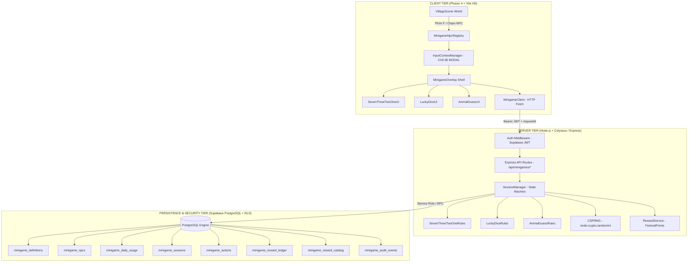
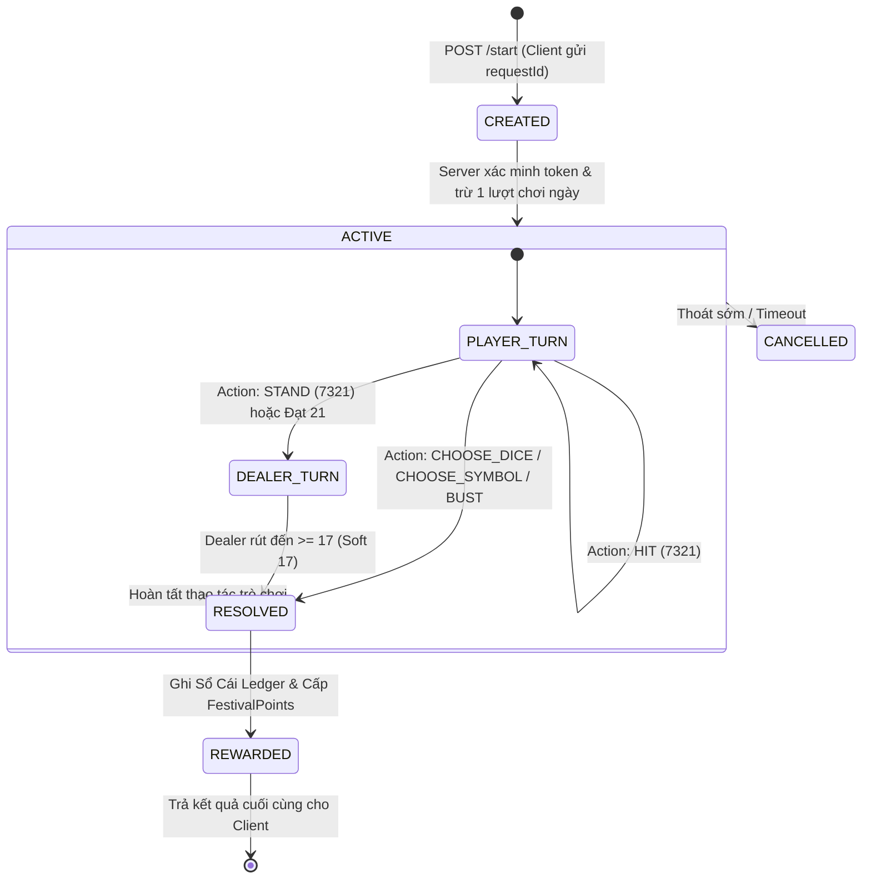

# KIẾN TRÚC KỸ THUẬT NPC MINIGAMES & FESTIVAL GACHA
## DỰ ÁN: THẦN MỆNH — HẬU DUỆ VĂN LANG (PHIÊN BẢN 1.0.0)

> **Mục tiêu tài liệu:** Trình bày chi tiết kiến trúc phân tầng ba lớp (Client — Authoritative Server — Database), cấu trúc dữ liệu kiểu mạnh (TypeScript Contracts), máy trạng thái ván chơi, bộ sinh ngẫu nhiên an toàn (CSPRNG), và cơ chế cô lập giao diện người dùng (Input Isolation Barrier).

---

## 1. SƠ ĐỒ KIẾN TRÚC TỔNG THỂ (THREE-TIER AUTHORITATIVE ARCHITECTURE)

Hệ thống tuân thủ nghiêm ngặt mô hình **Authoritative Server**: Client Phaser tuyệt đối không có quyền quyết định kết quả xúc xắc, bài chia, hay tự cộng điểm thưởng vào tài khoản.



### Phân Định Trách Nhiệm Từng Tầng:
1. **Client Tier (Phaser 4):**
   - Render đồ họa pixel art, hiệu ứng lắc bát xúc xắc, lật thẻ bài, mở linh hình.
   - Xử lý điều khiển người chơi (phím bấm, chuột, chạm màn hình).
   - Kích hoạt lớp chặn tương tác (`InputContextManager`) ngăn ngừa việc chém kiếm xuyên UI.
   - Gửi yêu cầu thao tác qua `MinigameClient` và hiển thị trạng thái do máy chủ phản hồi.
2. **Server Tier (Node.js Authoritative Service):**
   - Kiểm tra tính hợp lệ của token xác thực Supabase JWT (`auth.uid()`).
   - Kiểm tra điều kiện mở khóa NPC và hạn mức 3 lượt chơi/ngày theo múi giờ Việt Nam.
   - Sinh bài, xúc xắc bằng CSPRNG an toàn mật mã (`CSPRNG.ts`).
   - Quản lý máy trạng thái ván chơi và kiểm soát tính lũy đẳng (Idempotency) của từng action.
   - Tính toán điểm thưởng danh dự `FestivalPoints` qua `RewardService.ts`.
3. **Database Tier (Supabase PostgreSQL + RLS):**
   - Bảo vệ toàn bộ dữ liệu lịch sử, phiên chơi, hạn mức và sổ cái điểm thưởng bằng RLS.
   - Thực thi các thao tác ghi nguyên tử (Atomic Transactions) trong PostgreSQL Functions.
   - Tước toàn bộ quyền ghi trực tiếp từ phía client (chống gian lận SQL injection/Direct RPC).

---

## 2. VÒNG ĐỜI PHIÊN CHƠI & MÁY TRẠNG THÁI (SESSION LIFECYCLE)



### Chi Tiết Từng Bước Trong Vòng Đời:
1. **Khởi Tạo Phiên (`/start`):**
   - Client gửi `{ gameId, npcId, requestId }`.
   - Máy chủ kiểm tra `minigame_daily_usage` cho ngày hiện tại (múi giờ `Asia/Ho_Chi_Minh`). Nếu số lượt đã sử dụng $\ge 3$, trả về lỗi `DAILY_LIMIT_EXCEEDED`.
   - Tạo dòng phiên mới trong `minigame_sessions` với trạng thái `active`.
   - Trừ lượt chơi ngay tại thời điểm khởi tạo phiên để ngăn chặn người chơi đóng tab hoặc ngắt mạng nhằm bảo toàn lượt chơi (Anti-Disconnect-Abuse).
2. **Thực Hiện Thao Tác (`/action`):**
   - Client gửi `{ sessionId, actionId, type, payload }`.
   - Kiểm tra `actionId` trong `minigame_actions`. Nếu `actionId` đã tồn tại cho `sessionId` này, server trả về ngay lập tức trạng thái ván chơi đã lưu mà không xử lý lại (Idempotent Guard).
   - Máy trạng thái chuyển đổi hợp lệ:
     - 7321: `hit` thêm 1 lá bài; `stand` chuyển lượt sang dealer.
     - Xúc Xắc: `choose_dice` (tài/xỉu) chốt kết quả và chuyển sang `resolved`.
     - Đoán Thú: `choose_symbol` chốt kết quả và chuyển sang `resolved`.
3. **Phân Xử & Cấp Thưởng (`/resolve`):**
   - Mở toàn bộ lá bài bí mật (Secret State), tính toán thắng/thua/hòa và điểm thưởng.
   - Thực hiện ghi nhận phần thưởng vào bảng `minigame_reward_ledger` trong một transaction nguyên tử.
   - Chuyển trạng thái phiên sang `rewarded`. Trả `rewardReceiptId` về cho client hiển thị UI kết quả.

---

## 3. HỢP ĐỒNG DỮ LIỆU & TYPESCRIPT CONTRACTS

Hệ thống sử dụng chặt chẽ các kiểu dữ liệu phân biệt (Discriminated Unions) để đảm bảo an toàn kiểu xuyên suốt từ server tới client:

```typescript
// 1. Định danh minigame và trạng thái phiên
export type MinigameId = '7321' | 'lucky_dice' | 'animal_guess';

export type SessionStatus =
  | 'created'
  | 'active'
  | 'resolved'
  | 'rewarded'
  | 'cancelled'
  | 'expired';

// 2. Các hành động của người chơi (Discriminated Action Unions)
export type MinigameActionInput =
  | { type: 'hit' }
  | { type: 'stand' }
  | { type: 'choose_dice'; choice: 'tai' | 'xiu' }
  | { type: 'choose_symbol'; symbol: 'bau' | 'cua' | 'ca' | 'cop' | 'ga' | 'nai' }
  | { type: 'confirm' };

// 3. Cấu trúc phiên công khai trả về cho Client
export interface MinigamePublicSession {
  sessionId: string;
  gameId: MinigameId;
  userId: string;
  characterId: string;
  status: SessionStatus;
  rulesVersion: string;
  createdAt: number;
  updatedAt: number;
  publicState:
    | SevenThreeTwoOnePublicState
    | LuckyDicePublicState
    | AnimalGuessPublicState;
  remainingDailyPlays: number;
  reward?: RewardReceipt;
}

// 4. Biên nhận phần thưởng sau khi chốt sổ
export interface RewardReceipt {
  receiptId: string;
  sessionId: string;
  gameId: MinigameId;
  totalFestivalPoints: number;
  participationPoints: number;
  bonusPoints: number;
  outcomeDescription: string;
  timestamp: number;
}
```

### Cơ Chế Phân Tách Public State và Secret State:
- **Public State:** Dữ liệu client được phép biết tại thời điểm hiện tại:
  - Lá bài của người chơi và **chỉ 1 lá bài ngửa** của dealer (`dealerHand: [card1, { hidden: true }]`).
  - Điểm số hiện tại của người chơi.
  - Sau khi kết thúc: công bố đủ 3 mặt xúc xắc, tổng điểm, biểu tượng lật mở.
- **Secret State:** Được lưu trữ an toàn trong RAM máy chủ (hoặc bảng bảo mật chỉ service_role đọc):
  - Thứ tự các lá bài còn lại trong bộ bài (`remaining deck`).
  - Lá bài úp thứ hai của dealer (`dealerHiddenCard`).
  - Phía Client **tuyệt đối không bao giờ nhận được** Secret State trong JSON phản hồi khi ván chơi đang diễn ra, loại bỏ 100% nguy cơ hack soi bài từ Network Tab / F12 DevTools.

---

## 4. BỘ SINH SỐ NGẪU NHIÊN MẬT MÃ (CSPRNG)

Hệ sinh thái Minigame kiên quyết **không sử dụng `Math.random()`** trên cả máy chủ lẫn client cho bất kỳ quyết định phân xử kết quả nào. Thay vào đó, lớp `CSPRNG.ts` khai thác thư viện chuẩn `node:crypto.randomInt`:

### A. Thuật Toán Xáo Bài Fisher-Yates Chuẩn Mực
Để xáo bộ bài 52 lá của trò **7321**, thuật toán Fisher-Yates duyệt ngược từ cuối mảng về đầu và hoán vị với một vị trí ngẫu nhiên không thiên lệch:

```typescript
export function shuffleDeck<T>(deck: T[]): T[] {
  const result = [...deck];
  for (let i = result.length - 1; i > 0; i--) {
    // node:crypto.randomInt(min, max) sinh số nguyên trong khoảng [min, max)
    const j = crypto.randomInt(0, i + 1);
    const temp = result[i];
    result[i] = result[j];
    result[j] = temp;
  }
  return result;
}
```

### B. Gieo Xúc Xắc Độc Lập Không Bị Modulo Bias
- Xúc xắc 6 mặt: Gọi `crypto.randomInt(1, 7)` để nhận các giá trị $1, 2, 3, 4, 5, 6$.
- Linh vật Bách Việt: Gọi `crypto.randomInt(0, 6)` lấy index đồng đều cho 6 linh vật.
- Nguồn entropy lấy trực tiếp từ hệ điều hành (`/dev/urandom` trên Linux hoặc `BCryptGenRandom` trên Windows), bảo đảm không thể đoán trước (Unpredictable) và không bị suy biến theo chu kỳ giả lập.

---

## 5. HỆ THỐNG CÔ LẬP ĐIỀU KHIỂN (INPUT CONTEXT MANAGER & MODAL BARRIER)

Một vấn đề phổ biến trong các game Action RPG viết bằng Phaser là khi người chơi mở giao diện hội thoại hoặc bảng chơi minigame, các thao tác nhấp chuột trái trên màn hình thường bị "xuyên thấu" xuống thế giới, kích hoạt animation chém kiếm hoặc tấn công quái vật bên dưới.

Để giải quyết triệt để vấn đề này, module `InputContextManager.ts` thiết lập hàng rào bảo vệ (Modal Barrier):

```
                        NGƯỜI CHƠI NHẤP CHUỘT / PHÍM
                                     │
                                     ▼
                        [InputContextManager]
                                     │
           ┌─────────────────────────┴─────────────────────────┐
           ▼                                                   ▼
     [Chế độ WORLD]                                      [Chế độ MODAL]
  (Đang phiêu lưu Làng)                               (Đang mở Minigame)
           │                                                   │
   ├── Chuột trái: Tấn công kiếm                       ├── Chuột trái: Tương tác nút UI
   ├── WASD: Di chuyển nhân vật                        ├── Chặn pointerdown xuyên thấu
   └── Phím 1..4: Dùng kỹ năng                         └── Khóa hoàn toàn WASD & Phím 1..4
```

### Nguyên Lý Triển Khai Thực Tế:
1. **Lớp Chặn Sự Kiện (Event Absorber Layer):**
   - `MinigameOverlay` tạo một `Phaser.GameObjects.Rectangle` phủ kín toàn màn hình với `depth` cao, được gán `.setInteractive()`.
   - Lớp chắn này lắng nghe `pointerdown` và gọi `event.stopPropagation()`, ngăn chặn sự kiện chuột truyền tới camera và hệ thống tấn công của nhân vật chính.
2. **Chế Độ Bàn Phím Cô Lập:**
   - Khi modal mở: `InputContextManager.setContext('MODAL')`. Cờ `inputBlocked` của hệ thống điều khiển thế giới được bật.
   - Các phím số kỹ năng `1`, `2`, `3`, `4` và các phím di chuyển `W`, `A`, `S`, `D` bị vô hiệu hóa trong logic update của scene.
   - Phím `Esc` được gán riêng biệt để đóng modal an toàn.
3. **Phục Hồi Sạch Sẽ (Graceful Teardown):**
   - Khi người chơi đóng modal minigame: `InputContextManager.setContext('WORLD')`.
   - Trạng thái các phím được reset (tránh kẹt phím di chuyển hoặc kẹt đòn đánh), người chơi tiếp tục khám phá thế giới mượt mà.
