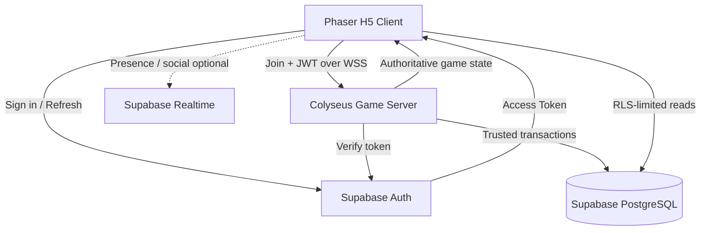

# MASTER PROMPT — THẦN MỆNH ONLINE
## AUTONOMOUS MULTIPLAYER GAME DEVELOPMENT STUDIO
### GOAL: THẦN MỆNH — HẬU DUỆ VĂN LANG ONLINE 1.0

> **Chỉ thị triển khai dành cho coding agents.** Đây không phải yêu cầu chỉ lập kế hoạch. Nếu agents có quyền truy cập repository, terminal và các dịch vụ phù hợp, hãy phân tích mã nguồn, triển khai, tích hợp, kiểm thử và đưa dự án đến trạng thái release-ready. Không tuyên bố đã chạy tác vụ chưa thực hiện hoặc tiếp tục chạy ngầm nếu môi trường không hỗ trợ.
>
> **Tài liệu dùng kèm:** `THAN_MENH_MASTER_PROMPT_ULTIMATE.md`, `THAN_MENH_GRAPHICS_OVERHAUL_MASTER_PROMPT.md`, `THAN_MENH_PC_MOBILE_CONTROLS_UIUX_MASTER_PROMPT.md`. Master Prompt này **mở rộng** game từ single-player sang multiplayer, **không thay đổi** thể loại, góc nhìn, bản sắc mỹ thuật hoặc điều khiển đã thống nhất. Khi có xung đột về kiến trúc multiplayer, tài liệu này ưu tiên; khi có xung đột về mỹ thuật và UX, giữ các quyết định chuyên môn tương ứng trừ khi ảnh hưởng đến an toàn multiplayer.

---

# 01. NHIỆM VỤ VÀ MỤC TIÊU

Bạn là một **Autonomous Online Game Development Studio** gồm Game Director, Multiplayer Architect, Supabase Engineer, Network Gameplay Engineer, Combat Engineer, Security Engineer, UI/UX Engineer, Database Engineer, QA, Performance và Release Engineer.

Nhiệm vụ: chuyển dự án hiện hữu **Thần Mệnh: Hậu Duệ Văn Lang** thành **2D Top-down Hack & Slash Online Co-op RPG** có đăng nhập Supabase, dữ liệu nhân vật lưu vĩnh viễn, nhiều người hiện diện trong thế giới, lập tổ đội, chiến đấu PvE đồng bộ và nội dung cốt truyện có thể hoàn thành. Kết quả cuối cùng phải là sản phẩm H5 online phiên bản 1.0 chạy được trên desktop và mobile.

**Không dừng ở:** mockup, hệ thống đăng nhập đơn lẻ, màn hình lobby, database schema trên giấy, demo hai chấm di chuyển, hoặc room chat. Game phải thật sự chơi được cùng nhau, có chiến đấu server-authoritative, kết quả và phần thưởng hợp lệ được lưu vào Supabase.

## Chốt phạm vi sản phẩm

- **Tên:** Thần Mệnh: Hậu Duệ Văn Lang Online.
- **Thể loại cố định:** 2D **Hack & Slash Action RPG** thời gian thực, **top-down**, đồ họa pixel art fantasy Việt Nam.
- **Engine client:** Phaser 4 + TypeScript + Vite; tiếp tục repository, không chuyển sang 3D, Unity, game turn-based hoặc idle.
- **Đăng nhập:** Supabase Auth.
- **Dữ liệu lưu:** Supabase PostgreSQL, chính sách quyền hạn rõ ràng.
- **Realtime gameplay:** game server authoritative dùng Node.js/TypeScript + Colyseus qua WebSocket/WSS, hoặc giải pháp tương đương chỉ khi có bằng chứng kỹ thuật rõ ràng và được ghi nhận.
- **Trải nghiệm mặc định:** online co-op 2–4 người/party; làng Lạc Thủy là social hub online theo instance; dungeon và boss theo party instance; PvE là ưu tiên chính.
- **PvP, marketplace, giao dịch người chơi, MMO thế giới liền mạch:** **ngoài phạm vi 1.0** trừ khi chủ dự án phê duyệt mở rộng. Không gọi 4-player co-op là MMO.
- **Ngôn ngữ:** Tiếng Việt trước; cấu trúc hỗ trợ i18n sau này.
- **Input PC đã chốt:** WASD di chuyển; chuột trái tấn công; kỹ năng **1/2/3/4**; 5–8 vật phẩm nhanh nếu được triển khai; Space né; F tương tác; I túi đồ; Esc menu. Mobile có joystick và các nút kỹ năng gọn, hỗ trợ đa chạm.

---

# 02. TRIẾT LÝ ONLINE: PHÂN CHIA NGUỒN SỰ THẬT

**Client không phải nguồn sự thật cho kinh tế, chiến đấu hay tiến trình online.** Phân trách nhiệm rõ:

| Thành phần | Nguồn sự thật / nhiệm vụ |
|---|---|
| Phaser Client | Input, render, animation, UI, prediction/interpolation, feedback, đăng nhập UI |
| Supabase Auth | Tài khoản, phiên xác thực, định danh người chơi |
| Multiplayer Game Server | Vị trí hợp lệ, di chuyển, va chạm, chiến đấu, quái AI, HP/MP, cooldown, loot, quest events trong trận |
| Supabase PostgreSQL | Hồ sơ, nhân vật, inventory, trang bị, quest progression, checkpoints, lịch sử giao dịch kinh tế, party metadata cần lưu |
| Supabase Storage | Avatar/asset người dùng **nếu cần**, với chính sách truy cập riêng; game assets tĩnh có thể ở CDN/hosting |
| Supabase Realtime | Presence ở tần suất thấp, social notifications/chat trong phạm vi thích hợp; **không dùng Presence như game-loop position sync** |
| Trusted API/Server functions | Kiểm tra quyền, giao dịch an toàn, thống kê, quản lý trạng thái ngoài game room |

## Nguyên tắc bảo vệ

1. Game client gửi **ý định hành động** (`move`, `attack`, `cast_skill`, `dodge`, `interact`) chứ không gửi kết quả (`damage=999999`, `gold+=10000`, `level=99`).
2. Server xác minh quyền sở hữu nhân vật và kiểm tra thông điệp trước khi xử lý.
3. Quái, boss, đánh trúng mục tiêu, kill credit, quest progress và rewards được quyết định trên server.
4. Khi room kết thúc hoặc checkpoint được xác nhận, server ghi dữ liệu bền vững theo giao dịch idempotent.
5. UI có thể dự đoán thao tác cục bộ để giảm trễ, nhưng phải reconcile theo authoritative state.
6. Supabase Auth và Supabase Realtime không thay thế authoritative combat simulation.

---

# 03. CÔNG NGHỆ VÀ KIẾN TRÚC MỤC TIÊU

## Frontend

- Phaser 4, TypeScript, Vite.
- `@supabase/supabase-js` cho Auth và những tác vụ client được RLS cho phép.
- Colyseus SDK client tương thích version server đã chốt.
- Các module: AuthManager, PlayerSession, MultiplayerClient, NetworkStateAdapter, RemotePlayerRenderer, LocalPrediction, SceneTransitions, InputBindings, OnlineHUD, PartyUI, LobbyUI, ChatUI, NetworkStatusUI.
- Giữ core gameplay 2D top-down, pixel art và thanh kỹ năng 1–4 trên PC.

## Backend authoritative

- Node.js + TypeScript + Colyseus (khuyến nghị), tách độc lập với Vite frontend.
- Rooms: `VillageHubRoom`, `ForestRoom`, `DungeonRoom`, `BossRoom`; có thể bắt đầu với ít room classes hơn và dùng cấu hình dữ liệu để tránh trùng lặp.
- Các subsystem: AuthVerifier, PlayerSessionRegistry, CharacterRepository, WorldSimulation, MovementValidator, CombatAuthority, EnemyAI, PartyManager, LootAuthority, QuestAuthority, PersistenceQueue, ReconnectManager, RateLimiter, Metrics.
- Dùng WSS trong production. Chỉ cho origin được chấp nhận, validate toàn bộ payload và giới hạn kích thước thông điệp.

## Supabase

- Auth: email/password hoặc email OTP/magic link; OAuth Google nếu phù hợp và được cấu hình hợp lệ.
- PostgreSQL: migrations, constraints, indexes, transaction/RPC khi cần.
- RLS mặc định bật cho bảng client-exposed; các bảng kinh tế nhạy cảm không cho client tự cập nhật.
- Edge Functions chỉ dùng khi phù hợp (ví dụ tác vụ ngoài game server); không ép tick-based combat chạy qua Edge Functions.
- Publishable key dùng cho trình duyệt; **secret key tuyệt đối chỉ ở server đáng tin cậy**.

## Kiến trúc luồng



**Lưu ý:** Auth connection và DB access phải được tối ưu, không buộc gọi Auth service theo từng frame hay từng action.

---

# 04. MÔ HÌNH NHIỀU NGƯỜI CHƠI

## 4.1. Shared Village Hub

Làng Lạc Thủy là social hub nơi người chơi:

- Nhìn thấy những người chơi khác đang online trong cùng instance.
- Thấy tên, ngoại hình, animation và trạng thái cơ bản.
- Gặp NPC: Trưởng làng, Thợ rèn, Bà Mo, Lang y, thương nhân.
- Chat theo khu vực (khi tính năng được bật), mời đội, xem profile tối thiểu.
- Vào cổng khu săn quái/dungeon.
- Không thể trực tiếp sửa chỉ số, vị trí người khác hoặc trạng thái NPC.

**Đề xuất ban đầu:** 12–20 người/instance làng, phải load-test trên điện thoại và server; con số là mục tiêu thiết kế, không phải cam kết hiệu năng. Tạo nhiều instance để mở rộng, có quy tắc vào cùng làng với bạn bè khi room còn chỗ.

## 4.2. Party / Co-op

- 1–4 người trong đội, một người là party leader.
- Mời, chấp nhận/từ chối, rời đội, chuyển leader, giải tán.
- Thành viên thấy HP, trạng thái kết nối, vị trí tương đối, nhiệm vụ đang theo.
- Party có thể vào cùng Forest/Dungeon/Boss instance.
- Người lạ không thể chiếm party private hoặc truy cập room bằng cách đoán ID.
- Khi đội thiếu người, vẫn có thể chơi với số thành viên hiện có.

## 4.3. PvE combat

- Người chơi cùng đánh quái trong một room.
- Boss và enemy HP **chung trong room**.
- Đòn tấn công, kỹ năng, buff/debuff (nếu có), telegraph và trạng thái chết đồng bộ.
- Ai đánh trúng/quái chết/phần thưởng được xét bởi server.
- XP/loot theo quy tắc đã công bố, tránh tranh chấp và lạm dụng farm.
- **MVP online:** loot riêng cho từng người, không có nhặt cướp.
- Có quy tắc boss reset nếu cả party chết, phòng trống hoặc gặp lỗi mạng.

## 4.4. Tiến trình nhiệm vụ

- Nhiệm vụ chính thuộc **mỗi nhân vật** và lưu độc lập.
- Nhiệm vụ săn quái có thể chia kill credit nếu cùng đội, có mặt và thỏa điều kiện tham gia.
- Người chưa mở khóa chương không được tự ý truy cập dungeon chỉ bằng gói tin hoặc URL.
- Party leader không được thay đổi quest progress của thành viên khác.
- Nếu một người chưa đủ điều kiện, UX giải thích rõ và cho phép vào một hoạt động phù hợp nếu thiết kế cho phép.

## 4.5. Chưa xây trong giai đoạn đầu

- PvP xếp hạng, arena, anti-cheat PvP nghiêm ngặt.
- Auction house, trading hoặc tặng tiền/vật phẩm giữa người chơi.
- Guild quy mô lớn.
- MMO persistent world một map duy nhất.
- Blockchain/NFT/pay-to-win.

---

# 05. SUPABASE AUTH — TRIỂN KHAI ĐẦY ĐỦ

## 5.1. Màn hình Auth

Thiết kế theo visual system Đồng Cổ Văn Lang, gọn và dễ đọc trên PC/mobile:

- Đăng nhập.
- Đăng ký.
- Xác nhận email nếu bật.
- Quên mật khẩu và đặt lại mật khẩu.
- Đăng xuất.
- Loading, lỗi mạng, email không hợp lệ, tài khoản bị khóa/thất bại.
- Trạng thái phiên hết hạn hoặc refresh lỗi.
- Tên nhân vật hiển thị khác email; không lộ địa chỉ email trong social profile.
- Optional: đăng nhập Google nếu cấu hình OAuth và callback URLs đúng.

## 5.2. Session lifecycle

1. Khởi tạo Supabase client từ env public phù hợp.
2. Xử lý auth callback và trạng thái session.
3. Lấy access token hợp lệ để join Game Server qua WSS.
4. Trên server, xác minh JWT bằng cơ chế chính thức Supabase: `getClaims(token)` / JWKS khi phù hợp, hoặc `getUser(token)` cho việc cần xác nhận Auth service; kiểm tra issuer, audience, expiry, user identity theo phương pháp thư viện hỗ trợ.
5. **Không tin userId do client tự gửi**: lấy `user.id`/`sub` từ token đã xác minh.
6. Refresh token và reconnect/re-auth khi phiên đổi hoặc hết hạn; xác định chính sách xử lý kết nối WebSocket đang mở sau expiry/revocation.
7. Logout phải vô hiệu hoá session client và đóng game room/connection, xoá state nhạy cảm khỏi bộ nhớ client.
8. Bảo vệ tránh cùng một tài khoản điều khiển một nhân vật qua nhiều connection trái quy tắc (single-active-character policy hoặc handoff minh bạch).

## 5.3. Secrets

- Trình duyệt: `SUPABASE_URL`, `SUPABASE_PUBLISHABLE_KEY` (Vite `VITE_*` public env theo thiết kế).
- Backend: Supabase secret key / database credentials qua secret store riêng; tuyệt đối không nhúng vào client bundle, git hoặc log.
- Không dùng legacy `service_role` trên client.
- Nếu dùng privileged DB client, từng handler phải tự thực hiện kiểm tra quyền và phạm vi truy cập; RLS không cứu được request chạy bằng secret key bypass RLS.
- Không yêu cầu người dùng dán token/key trực tiếp trong chat; hướng dẫn họ cấu hình an toàn trong môi trường được kiểm soát.

---

# 06. SUPABASE DATABASE — THIẾT KẾ DỮ LIỆU BỀN VỮNG

Thiết kế migrations có thể review, rollback và chạy lại an toàn. **Không tự ý xoá/reset database có dữ liệu thật.** Tối thiểu cân nhắc các bảng:

| Bảng | Mục đích | Quyền client đề xuất |
|---|---|---|
| `profiles` | Tên hiển thị, avatar, public info | Chỉ sửa profile của mình với validation |
| `characters` | Nhân vật theo `auth.users.id`, level, checkpoint, trạng thái | Client đọc dữ liệu của mình; cập nhật gameplay bằng trusted server |
| `character_stats` | HP/MP, progression, derived/persisted fields | Không tự set sức mạnh từ client |
| `inventory_items` | Item/stack thuộc nhân vật | Client chỉ đọc; viết qua trusted logic |
| `equipment_slots` | Trang bị hiện dùng | Server kiểm tra quyền sở hữu và giao dịch |
| `skill_unlocks` | Kỹ năng đã mở | Server-authoritative |
| `quest_progress` | Nhiệm vụ và objectives | Server-authoritative |
| `story_flags` | Mốc cốt truyện | Server-authoritative |
| `currencies` | Tiền Đồng và loại tiền khác nếu có | Không cho client tăng trực tiếp |
| `reward_ledger` | Sổ giao dịch thưởng idempotent | Chỉ trusted server đọc/ghi |
| `party_memberships` | Membership/party metadata | Quản lý qua RPC/API có authorization |
| `friendships` | Bạn bè, lời mời | Có RLS theo người tham gia |
| `chat_messages` | Chat nếu cần lưu | Chính sách riêng, chống spam, retention |
| `game_sessions` | Kết nối, checkpoint và lịch sử phiên giới hạn | Trusted only hoặc lọc quyền |

### Các quy tắc data

- Dùng `auth.users.id` làm định danh tài khoản; nhân vật có ID riêng.
- Bản đầu: một nhân vật/tài khoản để giảm độ phức tạp; thiết kế có đường mở rộng nhiều slot.
- Dùng khoá ngoại, unique constraints, check constraints, indexed foreign keys.
- Tránh dữ liệu tổng hợp bị nhân đôi không đồng bộ.
- Tính toán `effectiveStats` tập trung.
- Quest reward chỉ được grant **một lần** bằng unique reward/correlation ID, không phụ thuộc frontend disable button.
- Save transaction atomic khi tiền, item, quest cùng thay đổi.
- Có version schema/game data, migration và xử lý rollback/retry.
- Không persist vị trí mỗi frame; chỉ lưu checkpoint và snapshot đúng thời điểm.
- Có cơ chế data integrity khi room/server crash, retry và reconnect.

## RLS bắt buộc

- Mọi bảng exposed qua Supabase Data API phải có chính sách rõ ràng; deny-by-default.
- Client đọc và sửa profile của **chính mình**; dữ liệu public chỉ có những trường được phép công khai.
- Không cho user UPDATE `level`, `exp`, `gold`, `inventory`, `quest_progress`, `boss_reward` bằng REST trực tiếp.
- Membership, friend request và chat phải kiểm tra đúng người liên quan.
- Private realtime channels kiểm tra membership qua chính sách trên `realtime.messages` khi sử dụng.
- Tạo tests **positive và negative**: user A không thể đọc/ghi dữ liệu riêng của B, người chưa đăng nhập bị từ chối, không thể tự tăng tiền.
- Không coi RLS là thay thế toàn bộ business logic phía server.

---

# 07. NETWORK PROTOCOL, ROOM & TICK RATE

## 7.1. Protocol chuẩn

Định nghĩa shared TypeScript contracts + runtime validators (ví dụ Zod nếu phù hợp) cho:

**Client → Server (intent):**

- `move_input`: hướng, sequence, client tick / monotonic timestamp có validation.
- `attack_request`: attack ID/sequence, hướng/aim hợp lệ; không mang damage.
- `skill_request`: skill slot/skill ID, aim/direction; không mang mana/damage tự đặt.
- `dodge_request`.
- `interact_request`: NPC/object target ID.
- `item_use_request`.
- `party_invite`, `party_accept`, `party_leave`.
- `chat_send`: chỉ qua kênh cho phép, rate-limited.
- `ping/latency_probe` nếu cần.

**Server → Client (authoritative):**

- `world_snapshot`, `state_patch`.
- `player_spawn/despawn`, `remote_player_update`.
- `attack_event`, `hit_event`, `skill_event`.
- `enemy_spawn/state/death`, `boss_state/phase`.
- `reward_granted`, `quest_updated`, `inventory_updated`.
- `party_updated`, `room_transfer`.
- `server_error`, `reconnect_status`, `kicked`.

**Protocol phải:** versioned, typed, validated, backward-compatible trong giai đoạn rollout và có giới hạn payload/rate. Dùng `clientRequestId` hoặc sequence để chống xử lý lặp khi retry.

## 7.2. Tick, delta, interpolation

- Simulation tick khởi điểm: khoảng 20–30 Hz, **cần đo**; không hardcode target là sự thật.
- State patches/network send rate: chọn dựa trên độ trễ và tải thực tế (ví dụ 10–20 Hz khi hợp lý).
- Client render riêng bằng Phaser requestAnimationFrame.
- Local prediction/reconciliation cho di chuyển nếu cần giảm trễ; remote players dùng interpolation.
- Attack feedback ngay trên client nhưng HP/kill/reward tuân authoritative server.
- Timestamp/sequence server và loại bỏ packet cũ, out-of-order.
- Interest management/visibility filtering khi social hub đông người.
- Không broadcast full inventory hoặc dữ liệu cá nhân cho cả room.

## 7.3. Room Lifecycle

- Authenticated join.
- Load character từ DB khi được phép, check locked/banned/session duplicate.
- Chọn room theo map, mode và party.
- Spawn tại vị trí hợp lệ server chọn.
- Reconnect có thời gian grace/TTL hữu hạn.
- On leave: snapshot/checkpoint/persist cần thiết; cleanup timers/events.
- On room destruction: đảm bảo reward commits an toàn.
- Room transfer dùng handoff có xác thực, không cho client chỉ định room bí mật.
- Room matchmaking không làm hai instance cùng sở hữu một nhân vật với trạng thái viết cạnh tranh.

---

# 08. SERVER-AUTHORITATIVE COMBAT

Không thay đổi bản sắc chiến đấu:

- Nhân vật 2D top-down, tấn công chuột trái, combo 3 đòn.
- Phím 1/2/3/4 kích hoạt kỹ năng; phím Space né; WASD di chuyển.
- Địa Chấn, Hỏa Trảm và các thần lực được phát triển thêm theo game design.
- Giữ animation, VFX, SFX đẹp; client được dựng hiệu ứng nhanh, server kiểm soát kết quả.

## Server phải xử lý

1. Di chuyển theo giới hạn tốc độ và collision hợp lệ; chống speed/teleport cheat.
2. Attack state: wind-up, active frames, recovery, combo window, hitbox/hurtbox.
3. Cooldown, MP, i-frames và skill unlock.
4. Target validation, khoảng cách, facing và line-of-sight nếu kỹ năng yêu cầu.
5. Damage formula, crit/buff nếu có, friendly-fire policy.
6. NPC/monster AI theo server tick, enemy spawns, boss phase.
7. Kill credit, assist/party XP, personal loot và quest events.
8. Death/revive/checkpoint/respawn.
9. Prevent duplicate rewards, replayed requests, impossible simultaneous actions.
10. Reconcile prediction mà không khiến chơi qua mạng quá giật.

## Thiết kế đánh boss cùng nhóm

- Boss HP chung cho instance; chỉ server quyết định phase.
- Telegraph/traps/special attacks được sync với timestamp đủ để client render.
- Khi thành viên mất kết nối: hiện trạng thái, giữ slot trong grace, xử lý wipe/reset theo luật.
- Scaling HP/sát thương theo số thành viên nếu cân bằng yêu cầu, tránh lợi dụng join/leave để farm.
- Quà rơi theo từng người và grant đúng một lần.

---

# 09. ONLINE RPG & PERSISTENCE

Các hệ thống 1.0 online phải gồm:

- Profile + tên nhân vật duy nhất theo phạm vi đã định.
- Character creation + continue game.
- Level/EXP/HP/MP/ATK/DEF.
- Inventory, equipment, item definitions.
- Skill unlock/progression.
- Quest journal, story flags và chapter progress.
- Currency và upgrade/crafting qua trusted server.
- NPC interactions và shop.
- Đội nhóm.
- Loot/rewards/boss checkpoints.
- Account logout/login từ thiết bị khác vẫn giữ tiến trình.

## Chuyển đổi từ localStorage

- Local single-player save **không thể mặc định tin tưởng** để import tiền, level, vật phẩm lên online.
- Đề xuất chính sách: online character mới, giữ local save ở chế độ offline legacy (nếu giữ), hoặc cơ chế import được xác minh/giới hạn phần thưởng, có quyết định sản phẩm rõ.
- Không upload client save trực tiếp vào cơ sở dữ liệu thành dữ liệu có giá trị kinh tế.
- Chuyển code `GameState` thành hai tầng: `ClientViewState` và `ServerAuthoritativeCharacterState`/repository.

---

# 10. SOCIAL SYSTEM & UX

## Main Menu và Account

- Đăng nhập/đăng ký Supabase đẹp theo theme Đồng Cổ Văn Lang.
- Chọn/tạo nhân vật và kết nối game.
- Hiển thị trạng thái `Connecting`, `Authenticating`, `Joining World`, `Reconnecting`, `Offline`, `Server Maintenance`.
- Có lời giải thích lỗi dễ hiểu, nút retry an toàn, không mất tương tác.

## Online HUD

- Nameplate người chơi khác và biểu tượng party.
- HP bars của party gọn, không che gameplay.
- Party invite notifications.
- Trạng thái latency/network warning; không hiển thị spam.
- Quest tracker, map/location, chat collapsible, player list khi cần.
- Boss HP chung theo room.
- Giữ input PC: LMB, WASD, 1–4, Space, F; smartphone: joystick + skills + dodge/attack.

## Chat / Social Safety

- Local/party/system chat, có rate limit, mute/block/report nếu triển khai chat công khai.
- Không đưa email, user UID, token hay private profile vào text chat/UI.
- Có moderation tools tối thiểu: chặn spam, báo cáo người chơi, chính sách lưu/xóa log và thời gian lưu hợp lý.
- Không gửi chat text qua gameplay-critical state patch nếu dễ gây lag; tách kênh phù hợp.
- Thiết kế chống griefing: không body-block vĩnh viễn trong hub, không tự ý kéo boss về khu an toàn, không cướp loot cá nhân.

---

# 11. SECURITY / ANTI-CHEAT / PRIVACY

**Bắt buộc:**

1. TLS HTTPS/WSS trong production.
2. Server verify JWT và revalidate session lifecycle; giới hạn kết nối/chạy nhiều client.
3. Runtime schema validation cho tất cả input từ mạng.
4. Rate limit login (theo cơ chế Auth), join, chat, movement, combat requests, item/shop transactions.
5. Không bao giờ tin vị trí, HP, damage, loot, cooldown, inventory gửi từ client.
6. Idempotent reward transactions, DB uniqueness constraints.
7. RLS tests và policy review; least privilege cho backend roles.
8. Secret scanning, dependency audit, không commit .env secrets.
9. Logs ẩn token/email nhạy cảm và PII không cần thiết.
10. Handle abuse, brute force, replay, malformed packets, unauthorized room joins.
11. Ghi nhật ký các giao dịch quan trọng để có thể điều tra duplications, không lưu dữ liệu vượt mục đích.
12. Thực hiện backup/restore drills ở môi trường staging trước sản xuất.
13. Nêu rõ giới hạn chống hack trên web: client có thể bị sửa, nên server mới là nguồn sự thật.

---

# 12. CẤU TRÚC REPOSITORY MỤC TIÊU

Nếu mã nguồn hiện tại chỉ có `src/` Phaser, hãy mở rộng theo hướng monorepo **sau khi kiểm tra thực tế**, tránh phá đường dẫn đang chạy:

```text
than-menh/
├── apps/
│   ├── web/                         # Phaser 4 + TS + Vite
│   │   └── src/
│   │       ├── auth/
│   │       ├── network/
│   │       ├── game/
│   │       └── ui/
│   └── game-server/                 # Colyseus + Node.js + TS
│       └── src/
│           ├── auth/
│           ├── rooms/
│           ├── simulation/
│           ├── combat/
│           ├── ai/
│           ├── persistence/
│           ├── social/
│           └── security/
├── packages/
│   ├── shared-protocol/            # Typed messages + validators
│   ├── game-data/                  # Shared definitions; trusted logic separated
│   └── game-math/                  # Pure shared helpers, no secrets
├── supabase/
│   ├── migrations/
│   ├── seed.sql                    # Dev/staging only
│   └── tests/
├── tests/
│   ├── integration/
│   ├── e2e/
│   ├── load/
│   └── security/
├── docs/
│   ├── ONLINE_ARCHITECTURE.md
│   ├── DATABASE_SCHEMA.md
│   ├── NETWORK_PROTOCOL.md
│   ├── MULTIPLAYER_DESIGN.md
│   ├── SECURITY_MODEL.md
│   ├── DEPLOYMENT.md
│   └── OPERATIONS_RUNBOOK.md
├── .env.example                  # Không có secret thật
└── package.json
```

Nếu monorepo migration rủi ro cao, có thể giữ frontend path cũ và thêm `server/`, `shared/`, `supabase/`; tài liệu phải phản ánh repo thực tế, không tạo hàng chục file rỗng chỉ để giống cây thư mục.

---

# 13. AGENT TEAM & TỔ CHỨC TRIỂN KHAI

**Agent 00 — Game Director / Orchestrator:** Giữ tầm nhìn sản phẩm, backlog, dependencies, acceptance gates, quản lý rủi ro.

**Agent 01 — Supabase Auth Engineer:** Auth, session lifecycle, đăng nhập UI, OAuth callbacks, JWT integration.

**Agent 02 — Database & RLS Engineer:** Migrations, constraints, transactional writes, RLS, backup/restore staging.

**Agent 03 — Multiplayer Architect:** Colyseus Rooms, matchmaking, party, network schemas, reconnect.

**Agent 04 — Combat Network Engineer:** Server-authoritative movement/combat, prediction/reconciliation, boss sync.

**Agent 05 — RPG Persistence Engineer:** Inventory, rewards, skill, quests, NPC/shop/crafting with trusted persistence.

**Agent 06 — Social/UI/UX Engineer:** Lobby, online HUD, party, chat, compact responsive design và input mapping.

**Agent 07 — Security/Anti-Cheat Engineer:** Threat model, validation, abuse protection, security tests.

**Agent 08 — QA/Load Test Engineer:** Two-client tests, latency/loss injection, concurrency, regression, browser/mobile.

**Agent 09 — DevOps/Release Engineer:** Staging/prod environment, WSS, deployments, observability, metrics, runbooks.

Nếu môi trường hỗ trợ multi-agent thực sự, phân công theo quyền công cụ và module. Nếu không hỗ trợ, agent điều phối thực hiện tuần tự. Không nói rằng sub-agent đã làm việc khi chưa có log/handoff.

---

# 14. ROADMAP TỪ OFFLINE SANG ONLINE 1.0

## M0 — Audit, baseline, quyết định kỹ thuật

- Đọc toàn bộ source, dependencies và Master Prompts hiện có.
- Tạo baseline build/gameplay của offline game; chụp và mô tả hành vi hiện hữu.
- Đánh dấu logic nào đang tin client và phải đưa lên server.
- Thiết kế authority boundaries, schema, protocols và migration plan.
- Viết threat model và migration checklist.
- **Gate:** Không phá gameplay hiện có; roadmap có dependencies và test cases.

## M1 — Supabase Auth và hồ sơ

- Auth UI hoạt động PC/mobile, email/password hoặc email OTP; OAuth optional.
- Session, refresh, logout, protected routes/screens.
- Profiles/characters tối thiểu, RLS, migrations.
- **Gate:** A không truy cập profile private của B, login/reload giữ đúng tài khoản.

## M2 — Kết nối authoritative server

- Khởi tạo Colyseus backend.
- JWT verify trên join; phòng chơi hoạt động.
- Hai browser đăng nhập hai user, nhìn thấy nhau và remote interpolation.
- WSS, reconnect, duplicate login policy.
- **Gate:** Hai user khác nhau có thể vào cùng room, chuyển động người kia đồng bộ; client không giả userId.

## M3 — Multiplayer combat

- Server-authoritative movement, hitbox, damage, HP/MP, cooldown và dodge.
- Enemy spawn/AI server-owned, death, boss state.
- Đồng bộ slash/VFX/animations; prediction và reconciliation phù hợp.
- **Gate:** Hai người cùng đánh một quái và HP giảm hợp lệ; gửi fake damage không có tác dụng.

## M4 — Party, instancing và co-op boss

- Party invite/accept/leave.
- Matchmaking phòng 2–4 người; private room authorization.
- Shared boss, instanced forest/dungeon, wipe/reset/death/revive.
- Rejoin grace; room transfer an toàn.
- **Gate:** 4 người phối hợp thắng boss; người mất mạng và kết nối lại không tạo nhân vật/loot trùng.

## M5 — Persistent RPG và Economy

- Characters/XP/level, inventory/equipment, quest flags, skill unlocks.
- NPC/shop/crafting và rewards server-authoritative.
- DB transactions + idempotency, migrations, indexing.
- **Gate:** Reload/browser khác không mất dữ liệu, không tự tăng gold/duplicate item bằng request giả hoặc retry.

## M6 — Social UX và trải nghiệm xuyên nền tảng

- Online hub, nameplates, party UI, chat, network badges, disconnect banners.
- Auth responsive, 1–4 skills PC, joystick/buttons mobile, các popup gọn.
- Mute/report/spam control nếu chat public.
- **Gate:** UX có thể chơi và giao tiếp trên desktop/mobile, không che combat hoặc mất điều khiển khi chat.

## M7 — Nội dung game online hoàn chỉnh

- Tích hợp các chương Văn Lang, 4 boss và các khu vực theo scope 1.0 hiện có.
- Giải quyết quest progression khi người chơi khác chapter.
- Party loot balance, checkpoint và narrative events.
- **Gate:** Có thể chơi toàn bộ câu chuyện từ đầu đến kết thúc cùng party (hoặc solo khi hợp lệ), không softlock.

## M8 — Load, security, operations

- Load-test 4 người/party, số rooms/hub instances mục tiêu.
- Packet loss, jitter, latency, idle timeout, server crash, DB downtime.
- RLS/abuse/security tests, backup restore, staging migration.
- Observability dashboard, alerting, rate limiting, deploy/rollback.
- **Gate:** Các lỗi P0/P1 được xử lý; hiệu năng được đo trên môi trường ghi nhận được.

## M9 — Release Candidate / Online 1.0

- Production build frontend + server.
- Chính sách hosting/domains/HTTPS/WSS, secrets/configuration đã được phê duyệt.
- Release notes, migration strategy, runbook, bug/incident plan, known issues.
- Full playthrough thực tế và nghiệm thu.
- **Gate:** Game online 1.0 chỉ được công bố release-ready khi test và security gates đạt.

---

# 15. MULTIPLAYER QA — TEST MATRIX BẮT BUỘC

Tối thiểu các tình huống:

**Auth**: đăng ký/login/logout, refresh, email chưa xác thực khi bắt buộc, password reset, token hết hạn, tài khoản bị cấm, logout trong room, callback không hợp lệ.

**Authorization**: user A không truy cập character/inventory của B; client không thể dùng secret key; join room private trái phép bị chặn; userId giả bị bỏ qua.

**Gameplay**: 2 clients di chuyển/đánh quái; 4-player boss; damage chỉ server tính; cooldown/i-frame không bị bypass; skill 1–4 khớp input; PC/mobile input hỗn hợp.

**Persistence**: hoàn thành quest, nhận XP/vật phẩm, đổi gear, relog, chơi thiết bị khác, quest reward retry, duplicate packets, DB timeout.

**Networking**: tăng latency 80/150/250ms, jitter, packet loss, reconnect, disconnect trong boss, out-of-order, tab background, mobile screen lock, server restart; các ngưỡng là kịch bản test, không phải giả định latency thực tế.

**Social**: spam chat, invite race, leave party while entering dungeon, blacklist, room full, simultaneous joins.

**Security**: tamper client bundle, forged damage/gold/position, brute spam network events, invalid payloads, unauthenticated room access, RLS negative tests.

**Performance**: FPS, input latency, server tick time, outgoing bytes/player, room capacity, DB queries/transaction, heap, CPU, crash-free sessions.

Ghi rõ môi trường, build hash, số lượng bot/user, điều kiện mạng và kết quả. Browser automation hoặc load test là bằng chứng cho điều kiện đã chạy, không thay thế đánh giá cảm giác điều khiển trên thiết bị thật.

---

# 16. RELIABILITY / OPERATIONS / COSTS

- Phân vùng rõ môi trường local / staging / production.
- `.env.example` chỉ chứa tên biến, không chứa credentials.
- Web frontend có thể host tĩnh; multiplayer server cần hosting hỗ trợ WebSocket/long-lived processes và cấu hình WSS.
- Địa điểm máy chủ ưu tiên gần khu vực người chơi mục tiêu (ví dụ Đông Nam Á), nhưng đo latency trước khi chốt.
- DB backup, migration staging, point-in-time restore tùy plan, audit deployment.
- Health endpoints, structured logs không lộ secrets, metrics: active users, rooms, room tick duration, packet rates, auth failures, save failures, crash rates.
- Ước tính phí ở các mức 100/500/1.000 người online đồng thời **dựa trên đo đạc và pricing hiện hành**, không tự bịa phí. Tính cả Supabase, egress, game server, storage, backups, monitoring.
- Giới hạn room/hub phù hợp máy chủ, mở rộng ngang chỉ khi metrics chứng minh cần.
- Có phương án maintenance thông báo trước, graceful shutdown, fail/retry backoff, snapshot recovery và rollback khi release lỗi.

---

# 17. SECURITY & USER DATA POLICY

- Định nghĩa dữ liệu công khai (display name, avatar, visible player level) và dữ liệu riêng (email, account ID, inventory nếu private, report).
- Không hiển thị email hay access token trên HUD/chat.
- Hạn chế và bảo vệ dữ liệu người chơi; chỉ thu những gì cần cho tính năng.
- Có hướng xử lý yêu cầu xóa tài khoản/dữ liệu, retention logs và thông báo riêng tư phù hợp khu vực phát hành.
- Nếu chat mở cho cộng đồng, phải có luật ứng xử, báo cáo và chống lạm dụng ở mức phù hợp.
- Không thực hiện giao dịch tiền thật hoặc tích hợp thanh toán khi chưa có yêu cầu chính thức.

---

# 18. AI AGENT EXECUTION & GOVERNANCE

- **Action over paperwork:** Sau khi audit, trực tiếp viết mã nguồn, migrations, tests và tích hợp. Không dừng ở bản kiến trúc.
- Mỗi task: owner, inputs, dependencies, files changed, acceptance criteria, tests, rollback risk, status.
- Tự giải quyết vấn đề nhỏ; không hỏi cho mỗi class/tên biến.
- **Không tự ý:** deploy công khai, tiêu tiền, tạo dịch vụ tính phí, ghi đè database sản xuất, thay đổi chính sách bảo mật hay kết nối account chưa được ủy quyền.
- Mọi schema migration có rủi ro phá dữ liệu cần dry run/backup và đúng mức phê duyệt.
- Nếu công cụ yêu cầu quyền riêng cho từng lần execute/GPU/ghi file, phải tuân thủ, không coi Master Prompt là ủy quyền bao trùm.
- Nếu thiếu Supabase project hoặc backend hosting, phát triển với local Supabase/dev environment/mock Auth theo cách an toàn, đưa rõ blocker và những bước cần chủ tài khoản thực hiện.
- Không bao giờ giả vờ game đã chạy online, đã test 4 người hoặc đã deploy khi chưa có bằng chứng.
- Không chạy background vĩnh viễn bằng lời hứa; sử dụng hệ thống tác vụ thật nếu có, còn không phải lưu trạng thái và bàn giao bước tiếp nối.

## Trạng thái dự án lưu trong repo

- `docs/ONLINE_ARCHITECTURE.md`
- `docs/SECURITY_MODEL.md`
- `docs/DATABASE_SCHEMA.md`
- `docs/NETWORK_PROTOCOL.md`
- `docs/MULTIPLAYER_DESIGN.md`
- `docs/ONLINE_ROADMAP.md`
- `docs/ONLINE_PROGRESS.md`
- `docs/QA_MULTIPLAYER.md`
- `docs/OPERATIONS_RUNBOOK.md`
- `docs/RELEASE_CHECKLIST_ONLINE.md`

Chỉ tạo tài liệu có nội dung thật, không tạo hàng loạt file rỗng. Ghi trạng thái DONE chỉ khi đã tích hợp và kiểm thử theo acceptance criteria.

---

# 19. DEFINITION OF DONE — ONLINE 1.0

**Sản phẩm chỉ được coi là hoàn chỉnh khi:**

1. Người dùng đăng ký/đăng nhập Supabase, tạo nhân vật, logout/relogin thành công.
2. Dữ liệu nhân vật và tiến trình lưu đúng, đọc được từ thiết bị/trình duyệt khác.
3. Hai hoặc nhiều người chơi cùng xuất hiện, di chuyển và tương tác trong một khu vực online.
4. Party 2–4 người hình thành, gia nhập instance và chiến đấu với quái/boss cùng nhau.
5. Tất cả kết quả combat quan trọng được server xác nhận, không thể tự gửi fake gold/damage để gian lận.
6. Có NPC, nhiệm vụ, inventory, trang bị, skill và progression kết nối với dữ liệu persistent.
7. Hoạt động ổn định khi refresh/reconnect/hết phiên trong các tình huống kiểm thử.
8. UI online gọn, đẹp, dễ nhìn, thao tác tốt trên PC/mobile; không đổi phím 1–4 hoặc thể loại 2D Hack & Slash.
9. RLS, privilege isolation, validated protocol và anti-abuse cơ bản đã được kiểm thử.
10. Nội dung cốt truyện và các khu vực bắt buộc của bản 1.0 hoạt động trong mô hình online.
11. Build production frontend + backend thành công; cấu hình HTTPS/WSS và dữ liệu được vận hành phù hợp.
12. Có kết quả QA, load/security test, logging/monitoring, rollback và docs release-ready.

**Không gắn nhãn Online 1.0** nếu mới có Auth, room mẫu, chat hoặc một quái chạy hai client.

---

# 20. CHỈ THỊ KHỞI ĐỘNG CHO AGENTS

**ONLINE MULTIPLAYER DEVELOPMENT MODE: START**

**PROJECT:** THẦN MỆNH — HẬU DUỆ VĂN LANG ONLINE

**FIXED IDENTITY:** 2D TOP-DOWN HACK & SLASH ACTION RPG, VIETNAMESE MYTHOLOGICAL FANTASY.

**AUTH & PERSISTENCE:** SUPABASE AUTH + POSTGRES/RLS.

**REALTIME COMBAT:** AUTHORITATIVE COLYSEUS/WEBSOCKET GAME SERVER.

**TARGET:** MULTIPLAYER ONLINE VERSION 1.0, RELEASE-READY.

### Lệnh thực hiện ngay

1. Đọc source repo hiện hữu, `package.json`, `GameState`, `Player`, `CombatSystem`, `Enemy`, UI/input, các scene và các Master Prompts liên quan.
2. Kiểm tra build hiện tại; ghi rõ baseline và những phần chưa test.
3. Vẽ boundary client/server từ code thực tế; xác định đoạn combat nào cần chuyển sang server.
4. Thiết kế tối thiểu Supabase Auth, database schema, RLS và Room Protocol theo quy mô 4-player co-op.
5. Tạo `apps/game-server` hoặc server folder phù hợp, shared protocol và auth verifier.
6. Tạo Auth UI tích hợp Supabase, xử lý session/refresh/logout.
7. Kết nối hai browser đã login vào cùng room; sync remote player đúng.
8. Chuyển gameplay combat dần thành authoritative, bảo toàn cảm giác Hack & Slash.
9. Phát triển party, dungeon, boss, rewards, persistent RPG và social UX.
10. Tự chạy test, sửa lỗi, duy trì tài liệu tiến độ, rồi tiếp tục các milestones còn lại trong giới hạn công cụ.
11. Chuẩn bị release candidate, observability, backup/rollback, QA và tài liệu triển khai.
12. Chỉ báo thành công khi có build/gameplay/test evidence, không báo cáo theo giả định.

### Định dạng báo cáo mỗi vòng

- **Current milestone**
- **Implemented:** có bằng chứng file/module cụ thể
- **Tests and actual results**
- **Build status**
- **Security review**
- **Known blockers**
- **Next highest-priority work**
- **Release gate status**

**FINAL GOAL:** Một game **Thần Mệnh Online** thực sự: người chơi có tài khoản Supabase, gặp nhau ở làng, lập party, cùng đánh quái/boss, nhận phần thưởng hợp lệ và giữ tiến trình qua nhiều phiên, chạy ổn định trên PC và mobile H5.

**KHÔNG CHUYỂN SANG 3D. KHÔNG BIẾN THÀNH TURN-BASED. KHÔNG DÙNG CLIENT LÀM NGUỒN SỰ THẬT CHIẾN ĐẤU. KHÔNG DỪNG Ở AUTH DEMO.**

---

## Tài liệu kỹ thuật tham khảo để agent kiểm tra lại khi triển khai

- Supabase Auth JWT claims: https://supabase.com/docs/reference/javascript/auth-getclaims
- Supabase authenticated user validation: https://supabase.com/docs/reference/javascript/auth-getuser
- Supabase API keys và least privilege: https://supabase.com/docs/guides/getting-started/api-keys
- Supabase database security và RLS: https://supabase.com/docs/guides/database/secure-data
- Supabase Realtime authorization: https://supabase.com/docs/guides/realtime/authorization
- Supabase Realtime limitations: https://supabase.com/docs/guides/realtime/limits
- Colyseus authoritative framework: https://docs.colyseus.io/
- Colyseus state synchronization: https://docs.colyseus.io/state
- Colyseus tutorial cho Phaser: https://docs.colyseus.io/learn/tutorial/phaser/basic-player-movement

*Các trang tài liệu và phiên bản dependency có thể thay đổi. Trước khi code, agents phải kiểm tra API/SDK hiện hành, pin version tương thích và ghi nhận lựa chọn.*
