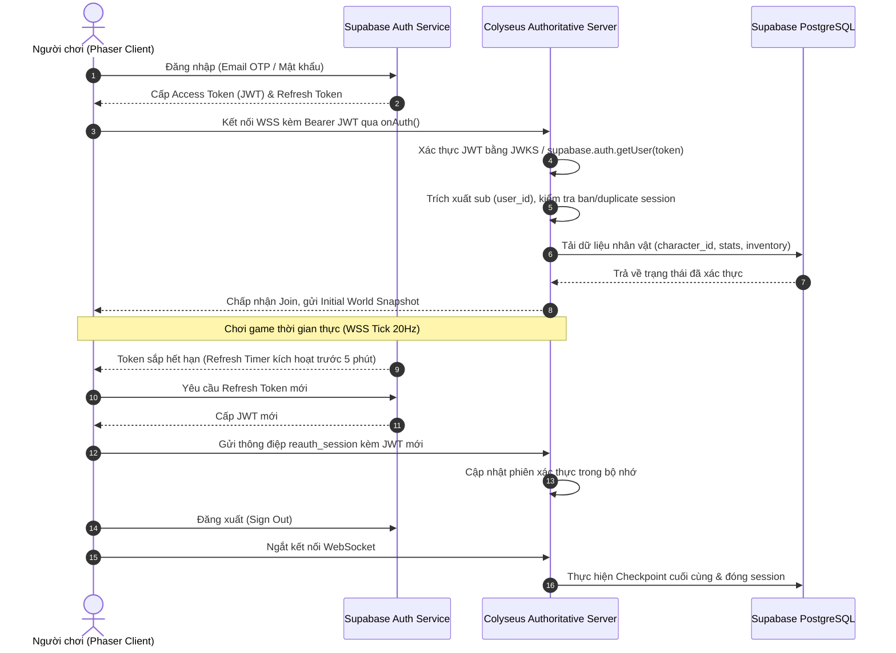
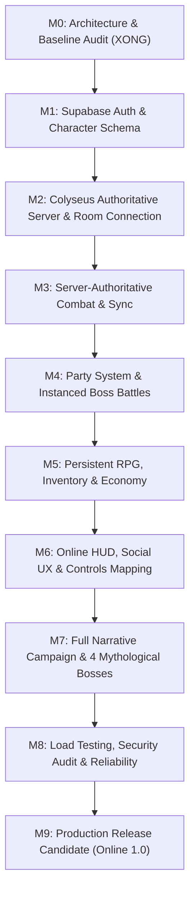

# THẦN MỆNH ONLINE 1.0 — KIẾN TRÚC HỆ THỐNG & KẾ HOẠCH CHUYỂN ĐỔI (M0 AUDIT)

> **Tài liệu tham chiếu:** `THAN_MENH_ONLINE_MULTIPLAYER_SUPABASE_MASTER_PROMPT.md` (Mục 01–09, 11–18).  
> **Trạng thái thực thi:** Milestone M0 — Read-only Architecture & Gap Audit.  
> **Phạm vi sở hữu file:** Chỉ tạo `docs/ONLINE_M0_AGY_ARCHITECTURE.md`. Không chỉnh sửa mã nguồn hiện hành, không cài đặt dependency, không tạo server process.

---

## 1. TỔNG QUAN VÀ TRẠNG THÁI MILESTONE HIỆN TẠI (CURRENT MILESTONE: M0)

Dự án **Thần Mệnh: Hậu Duệ Văn Lang** hiện tại là game offline single-player 2D Hack & Slash Action RPG viết trên nền tảng **Phaser 4 + TypeScript + Vite**. Toàn bộ mã nguồn chạy 100% trong browser của người chơi, lưu trữ trạng thái vào `localStorage`.

### Đánh giá hiện trạng M0:
- **Runtime Code:** Đang ở trạng thái single-player hoàn chỉnh với hệ thống combat, vũ khí, kỹ năng 4 nguyên tố, 4 chương cốt truyện, 4 boss thần thoại, và hệ thống điều khiển PC/mobile responsive.
- **Mã nguồn Multiplayer / Backend:** **0%**. Chưa có mã nguồn runtime cho Supabase Auth, Colyseus game server, WebSocket handling, PostgreSQL schema, RLS policies hay network synchronization.
- **Trạng thái kiểm thử Baseline hiện tại:** Toàn bộ test suites offline (`check:save`, `check:rpg`, `check:controls`, `check:player-status`) và TypeScript build (`npm run build`) đều đạt kết quả **PASS**.
- **Mục tiêu tài liệu:** Thiết lập thiết kế kỹ thuật tối thiểu, phân chia ranh giới thẩm quyền (authority boundaries), hợp đồng giao thức (contracts), lược đồ cơ sở dữ liệu (schema & RLS), mô hình bảo mật và lộ trình M1–M9 để chuyển đổi dự án lên phiên bản **Online 1.0** an toàn, không phá vỡ gameplay hiện có.

---

## 2. BẰNG CHỨNG KIỂM CHỨNG MÃ NGUỒN HIỆN HỮU (VERIFIED EXISTING CODE EVIDENCE)

Dưới đây là đối chiếu chi tiết giữa hiện trạng mã nguồn trong repository và ranh giới thẩm quyền mục tiêu:

| Phân hệ | File & Ký hiệu mã nguồn thực tế | Hành vi hiện tại (Single-Player Client) | Đánh giá rủi ro bảo mật & Bất cập Online | Ranh giới đích (Multiplayer Authoritative) |
|---|---|---|---|---|
| **Lưu trữ & Dữ liệu** | `src/game/systems/GameState.ts`<br>- `SaveData` (`:10-18`)<br>- `SAVE_KEY` (`:30`)<br>- `normalizeSave()` (`:74-134`)<br>- `GameState.earn()` (`:181-198`) | Đọc/ghi JSON trực tiếp vào `localStorage` key `than-menh-van-lang-mvp-v1`. Hàm `earn()` tự cộng tiền, XP, nâng cấp chỉ số và gọi `save()` ngay trong browser. | **P0 - Critical**: Client là nguồn sự thật tuyệt đối. Người chơi có thể sửa `localStorage` hoặc can thiệp JS console để sửa gold, level, trang bị thành giá trị tối đa. | Tách thành 2 tầng: `ClientViewState` (chỉ hiển thị/dự đoán) và PostgreSQL database qua trusted game server. |
| **Di chuyển & Vật lý** | `src/game/entities/Player.ts`<br>- `update()` (`:226-294`)<br>- `moveInWorld()` (`:278-281`)<br>- `dodge()` (`:366-377`)<br>`src/game/world/WorldBounds.ts`<br>- `moveInWorld()` (`:1-73`) | Client nhận input từ `InputManager`, tự tính vector vận tốc `vx, vy`, tự kiểm tra barrier và gán trực tiếp tọa độ `this.view.setPosition(next.x, next.y)`. Dodge cấp i-frame cục bộ. | **P0 - Critical**: Nguy cơ speed hack, noclip xuyên tường, teleportation, bất tử vô hạn bằng cách giả mạo thời gian dodge và vị trí. | Client chỉ gửi `move_input` và `dodge_request`. Server chạy tick 20–30Hz, mô phỏng vị trí theo giới hạn tốc độ và collision box, sau đó broadcast state patch. |
| **Chiến đấu & Sát thương** | `src/game/systems/CombatSystem.ts`<br>- `basic()` (`:27-72`)<br>- `skill()` (`:74-96`)<br>`src/game/systems/SkillCombat.ts`<br>- `castEquippedSkill()` (`:4-6`)<br>- `skillHitsTarget()` (`:8-17`) | Client tính toán xúc xắc bạo kích `Math.random() < weapon.criticalChance`, kiểm tra góc quét / khoảng cách hitbox, rồi trực tiếp gọi `enemy.damage()` hoặc `bossSystem.damageBoss()`. | **P0 - Critical**: Client tự quyết định ai trúng đòn, lượng sát thương gây ra, và trừ máu mục tiêu. Cheater có thể gửi sát thương 999,999 hoặc tầm đánh toàn màn hình. | Client chỉ kích hoạt animation & VFX dự đoán. Server nhận intent, kiểm tra khoảng cách, góc nhìn, cooldown, MP, tính toán sát thương, và gửi broadcast `hit_event`. |
| **Quái & Trùm (AI)** | `src/game/entities/Enemy.ts`<br>- `update()` (`:113-245`)<br>- `damage()` (`:265-282`)<br>`src/game/systems/BossSystem.ts`<br>- `startEncounter()` (`:153-185`)<br>- `update()` (`:341-371`)<br>- `damageBoss()` (`:221-228`) | AI quái và boss chạy trên vòng lặp `requestAnimationFrame` của Phaser. Quái tự gọi `player.hit()`. Boss tự chuyển phase và tạo hazard cục bộ. | **P1 - High**: Nếu chạy nhiều client, quái trên máy mỗi người sẽ di chuyển khác nhau, mục tiêu tấn công lệch nhau, dẫn đến desync hoàn toàn. | Toàn bộ Enemy AI, Boss AI, trạng thái nộ, đòn diện rộng (whirlpool, fissure) do Colyseus Room quản lý; sync sang client qua Colyseus Schema. |
| **Phần thưởng & Tiến trình** | `src/game/scenes/ForestScene.ts`<br>- `onEnemyKilled()` (`:201-219`)<br>- `onBossDefeated()` (`:221-230`)<br>`src/game/rpg/QuestSystem.ts`<br>- `claimNpcQuests()` (`:90-113`) | Khi quái chết, scene gọi `gameState.earn()`, tăng biến `kills`, cộng chìa khóa dungeon vào `storyFlags`. Khi xong quest, tự cộng vật phẩm vào inventory. | **P0 - Critical**: Cheater có thể gọi lặp lại hàm nhận thưởng, nhân bản vật phẩm hoặc hoàn thành quest ngay lập tức mà không cần đánh quái. | Mọi kill credit, rơi đồ, trả nhiệm vụ được server xác thực và ghi vào Supabase qua giao dịch idempotent có mã correlation ID duy nhất. |
| **Xác thực & Danh tính** | `src/game/scenes/MenuScene.ts`<br>- `create()` (`:24-100`)<br>- `startGame()` (`:64`) | Menu chỉ có nút "BẮT ĐẦU" / "CHƠI LẠI TỪ ĐẦU". Không có khái niệm tài khoản, phiên đăng nhập hay định danh người chơi. | **P1 - High**: Không có cơ chế nhận diện người chơi, không thể lưu tiến trình đa thiết bị, không thể quản lý bạn bè hay tổ đội. | Tích hợp Supabase Auth (Email OTP/Password + Google OAuth) với màn hình Auth tuân thủ hệ thống mỹ thuật Đồng Cổ Văn Lang. |

---

## 3. THIẾT KẾ CƠ SỞ DỮ LIỆU SUPABASE POSTGRESQL & ROW LEVEL SECURITY (RLS)

Để đáp ứng nguyên tắc **Zero Trust đối với Client**, mọi dữ liệu nhạy cảm liên quan đến chỉ số, tiền tệ, vật phẩm và tiến trình cốt truyện phải do Server kiểm soát.

### 3.1. Thiết kế Lược đồ (Schema Definition)

```sql
-- 1. Hồ sơ người chơi (Công khai một phần cho social hub)
CREATE TABLE public.profiles (
    id UUID PRIMARY KEY REFERENCES auth.users(id) ON DELETE CASCADE,
    display_name TEXT UNIQUE NOT NULL CHECK (char_length(display_name) BETWEEN 3 AND 24),
    avatar_url TEXT,
    created_at TIMESTAMPTZ NOT NULL DEFAULT now(),
    updated_at TIMESTAMPTZ NOT NULL DEFAULT now()
);

-- 2. Nhân vật người chơi (Mỗi user sở hữu 1 nhân vật ở bản 1.0)
CREATE TABLE public.characters (
    id UUID PRIMARY KEY DEFAULT gen_random_uuid(),
    user_id UUID NOT NULL REFERENCES auth.users(id) ON DELETE CASCADE,
    name TEXT NOT NULL CHECK (char_length(name) BETWEEN 2 AND 20),
    level INT NOT NULL DEFAULT 1 CHECK (level BETWEEN 1 AND 99),
    xp INT NOT NULL DEFAULT 0 CHECK (xp >= 0),
    gold INT NOT NULL DEFAULT 0 CHECK (gold >= 0),
    chapter INT NOT NULL DEFAULT 1 CHECK (chapter BETWEEN 1 AND 4),
    kills INT NOT NULL DEFAULT 0 CHECK (kills >= 0),
    checkpoint TEXT NOT NULL DEFAULT 'village-gate',
    playtime_seconds INT NOT NULL DEFAULT 0 CHECK (playtime_seconds >= 0),
    created_at TIMESTAMPTZ NOT NULL DEFAULT now(),
    updated_at TIMESTAMPTZ NOT NULL DEFAULT now(),
    CONSTRAINT uq_user_character UNIQUE (user_id)
);

-- 3. Chỉ số nhân vật cơ bản và dẫn xuất
CREATE TABLE public.character_stats (
    character_id UUID PRIMARY KEY REFERENCES public.characters(id) ON DELETE CASCADE,
    hp INT NOT NULL CHECK (hp >= 0),
    mp INT NOT NULL CHECK (mp >= 0),
    max_hp INT NOT NULL CHECK (max_hp >= 100),
    max_mp INT NOT NULL CHECK (max_mp >= 50),
    attack INT NOT NULL CHECK (attack >= 10),
    speed INT NOT NULL DEFAULT 210,
    updated_at TIMESTAMPTZ NOT NULL DEFAULT now()
);

-- 4. Hòm đồ (Inventory Items)
CREATE TABLE public.inventory_items (
    id UUID PRIMARY KEY DEFAULT gen_random_uuid(),
    character_id UUID NOT NULL REFERENCES public.characters(id) ON DELETE CASCADE,
    item_id TEXT NOT NULL,
    quantity INT NOT NULL CHECK (quantity > 0),
    slot_index INT NOT NULL CHECK (slot_index BETWEEN 0 AND 47),
    created_at TIMESTAMPTZ NOT NULL DEFAULT now(),
    CONSTRAINT uq_character_slot UNIQUE (character_id, slot_index)
);

-- 5. Trang bị hiện tại
CREATE TABLE public.equipment_slots (
    character_id UUID PRIMARY KEY REFERENCES public.characters(id) ON DELETE CASCADE,
    weapon_item_id TEXT,
    armor_item_id TEXT,
    accessory_item_id TEXT,
    updated_at TIMESTAMPTZ NOT NULL DEFAULT now()
);

-- 6. Kỹ năng đã mở khóa và gán phím
CREATE TABLE public.skill_unlocks (
    character_id UUID NOT NULL REFERENCES public.characters(id) ON DELETE CASCADE,
    skill_id TEXT NOT NULL,
    equipped_slot TEXT CHECK (equipped_slot IN ('slot-1', 'slot-2', 'slot-3', 'slot-4')),
    unlocked_at TIMESTAMPTZ NOT NULL DEFAULT now(),
    PRIMARY KEY (character_id, skill_id)
);

-- 7. Tiến trình nhiệm vụ
CREATE TABLE public.quest_progress (
    character_id UUID NOT NULL REFERENCES public.characters(id) ON DELETE CASCADE,
    quest_id TEXT NOT NULL,
    stage TEXT NOT NULL CHECK (stage IN ('new', 'active', 'return', 'complete')),
    counts JSONB NOT NULL DEFAULT '{}'::jsonb,
    flags JSONB NOT NULL DEFAULT '{}'::jsonb,
    reward_claimed BOOLEAN NOT NULL DEFAULT FALSE,
    updated_at TIMESTAMPTZ NOT NULL DEFAULT now(),
    PRIMARY KEY (character_id, quest_id)
);

-- 8. Cờ cốt truyện (Story Flags)
CREATE TABLE public.story_flags (
    character_id UUID NOT NULL REFERENCES public.characters(id) ON DELETE CASCADE,
    flag TEXT NOT NULL,
    value BOOLEAN NOT NULL DEFAULT TRUE,
    updated_at TIMESTAMPTZ NOT NULL DEFAULT now(),
    PRIMARY KEY (character_id, flag)
);

-- 9. Sổ cái phần thưởng Idempotent (Chống duplicate rewards)
CREATE TABLE public.reward_ledger (
    id UUID PRIMARY KEY DEFAULT gen_random_uuid(),
    character_id UUID NOT NULL REFERENCES public.characters(id) ON DELETE CASCADE,
    correlation_id TEXT UNIQUE NOT NULL, -- Ví dụ: quest_reward:char_123:hunt-ho-yeu
    reward_type TEXT NOT NULL,           -- 'quest', 'boss', 'dungeon'
    gold INT NOT NULL DEFAULT 0,
    xp INT NOT NULL DEFAULT 0,
    items JSONB NOT NULL DEFAULT '[]'::jsonb,
    granted_at TIMESTAMPTZ NOT NULL DEFAULT now()
);

-- 10. Phiên kết nối và Checkpoint
CREATE TABLE public.game_sessions (
    id UUID PRIMARY KEY DEFAULT gen_random_uuid(),
    character_id UUID NOT NULL REFERENCES public.characters(id) ON DELETE CASCADE,
    room_id TEXT NOT NULL,
    server_node_id TEXT NOT NULL,
    connected_at TIMESTAMPTZ NOT NULL DEFAULT now(),
    disconnected_at TIMESTAMPTZ,
    status TEXT NOT NULL CHECK (status IN ('active', 'disconnected', 'terminated'))
);
```

### 3.2. Chính sách Row Level Security (RLS) Bắt buộc

Mọi bảng đều phải bật RLS (`ALTER TABLE ... ENABLE ROW LEVEL SECURITY;`).

1. **`profiles`:**
   - `SELECT`: Mọi người dùng đã đăng nhập (`auth.role() = 'authenticated'`) đều đọc được tên hiển thị và avatar.
   - `INSERT / UPDATE`: Chỉ chủ sở hữu được sửa (`auth.uid() = id`).
2. **`characters`, `character_stats`, `inventory_items`, `equipment_slots`, `skill_unlocks`, `quest_progress`, `story_flags`:**
   - `SELECT`: Chỉ đọc được dữ liệu của chính mình:
     ```sql
     CREATE POLICY "Users read own character data"
     ON public.characters FOR SELECT
     TO authenticated
     USING (auth.uid() = user_id);
     ```
   - `INSERT / UPDATE / DELETE`: **DENY TO ALL CLIENT ROLES (`USING (false)`)**. Mọi thao tác ghi dữ liệu chiến đấu, kinh tế, chỉ số nhân vật chỉ được thực hiện bởi Server tin cậy thông qua `service_role` hoặc RPC nội bộ.
3. **`reward_ledger`, `game_sessions`:**
   - `REVOKE ALL ON public.reward_ledger FROM anon, authenticated;`
   - Bảng này hoàn toàn ẩn khỏi REST API của Supabase client. Chỉ Server game mới có quyền đọc/ghi.

---

## 4. GIAO THỨC PHÒNG CHƠI VÀ THẨM QUYỀN MÁY CHỦ COLYSEUS (SHARED ROOM PROTOCOL)

Hệ thống multiplayer sử dụng **Colyseus authoritative server** chạy Node.js/TypeScript. Giao thức mạng phân định rõ ràng giữa **Ý định hành động (Intents)** từ Client và **Trạng thái thẩm quyền (Authoritative State)** từ Server.

### 4.1. Thông điệp Client gửi Server (Client Intents)

Mọi gói tin gửi từ client đều được validate bằng Zod schema tại cửa vào server:

```typescript
// 1. Ý định di chuyển (20-30Hz)
export interface MoveIntent {
  seq: number;          // Sequence counter tăng dần để phát hiện trễ/lặp
  tick: number;         // Client timestamp / frame index
  dirX: number;         // Vector hướng chuẩn hóa (-1.0 đến 1.0)
  dirY: number;
}

// 2. Ý định né đòn (Dodge)
export interface DodgeIntent {
  seq: number;
  dirX: number;
  dirY: number;
}

// 3. Ý định tấn công thường
export interface AttackIntent {
  seq: number;
  comboStep: number;    // Client dự đoán combo (1, 2, 3)
  aimX: number;         // Hướng ngắm chuột hoặc phím điều hướng
  aimY: number;
}

// 4. Ý định dùng kỹ năng (Phím 1-4)
export interface SkillIntent {
  seq: number;
  slot: 'slot-1' | 'slot-2' | 'slot-3' | 'slot-4';
  aimX: number;
  aimY: number;
}

// 5. Ý định tương tác (Phím F)
export interface InteractIntent {
  targetId: string;     // ID của NPC, cổng làng, cổng dungeon, hoặc quest marker
  kind: 'npc' | 'portal' | 'dungeon_gate' | 'quest_rune';
}

// 6. Ý định sử dụng vật phẩm nhanh
export interface UseQuickItemIntent {
  quickSlotIndex: number;
  itemId: string;
}

// 7. Ý định tổ đội (Party)
export interface PartyActionIntent {
  action: 'invite' | 'accept' | 'decline' | 'leave' | 'kick' | 'transfer_lead';
  targetCharacterId?: string;
}
```

### 4.2. Trạng thái và Thông điệp Server gửi Client (Server Authoritative)

Đồng bộ qua **Colyseus State Schema** ở tần suất 20Hz:

```typescript
import { Schema, type, MapSchema } from '@colyseus/schema';

export class NetworkPlayerState extends Schema {
  @type("string") id: string = "";
  @type("string") characterId: string = "";
  @type("string") displayName: string = "";
  @type("number") x: number = 0;
  @type("number") y: number = 0;
  @type("number") vx: number = 0;
  @type("number") vy: number = 0;
  @type("string") facing: string = "down";
  @type("string") visualState: string = "idle";
  @type("number") hp: number = 100;
  @type("number") maxHp: number = 100;
  @type("number") mp: number = 50;
  @type("number") maxMp: number = 50;
  @type("number") level: number = 1;
  @type("string") weaponId: string = "copper-blade";
  @type("boolean") isInvulnerable: boolean = false;
  @type("boolean") isShielded: boolean = false;
}

export class NetworkEnemyState extends Schema {
  @type("string") id: string = "";
  @type("string") kind: string = "";
  @type("number") x: number = 0;
  @type("number") y: number = 0;
  @type("number") hp: number = 100;
  @type("number") maxHp: number = 100;
  @type("string") visualState: string = "idle";
  @type("string") facing: string = "down";
}

export class NetworkBossState extends Schema {
  @type("string") bossId: string = "";
  @type("number") x: number = 0;
  @type("number") y: number = 0;
  @type("number") hp: number = 1000;
  @type("number") maxHp: number = 1000;
  @type("number") shield: number = 0;
  @type("number") phaseIndex: number = 1;
  @type("string") visualState: string = "idle";
  @type("string") activeAttackId: string = "";
}

export class WorldRoomState extends Schema {
  @type({ map: NetworkPlayerState }) players = new MapSchema<NetworkPlayerState>();
  @type({ map: NetworkEnemyState }) enemies = new MapSchema<NetworkEnemyState>();
  @type(NetworkBossState) boss = new NetworkBossState();
  @type("number") serverTick: number = 0;
}
```

Các sự kiện tức thời (Events) được gửi qua message stream riêng:
- `s2c_damage_feedback`: `{ targetId, amount, isCritical, x, y }` (dùng để vẽ số sát thương bay `floatText`).
- `s2c_reward_notification`: `{ xp, gold, items }` (hiển thị toast phần thưởng).
- `s2c_reconciliation`: `{ lastProcessedSeq, x, y, vx, vy }` (sửa sai lệch dự đoán di chuyển trên client).
- `s2c_room_transfer_ticket`: `{ targetRoom, token, host }` (vé chuyển vùng an toàn).

---

## 5. VÒNG ĐỜI XÁC THỰC VÀ BẢO MẬT PHIÊN LÀM VIỆC (SUPABASE AUTH & SESSION)



### Quy tắc bảo vệ phiên:
1. **Tuyệt đối không tin `userId` do client gửi:** Server luôn trích xuất `sub` từ JWT đã ký điện tử. Mọi gói tin chứa `userId` tự khai báo sẽ bị hủy ngay.
2. **Chính sách Single Active Session:** Mỗi tài khoản chỉ được phép có 1 kết nối WebSocket hoạt động tại một thời điểm. Nếu phát hiện kết nối mới từ thiết bị khác, server sẽ ngắt kết nối cũ với mã lỗi `DUPLICATE_LOGIN`.
3. **Quản lý khóa (Secrets Posture):**
   - Web Client: Chỉ chứa biến môi trường công khai `VITE_SUPABASE_URL` và `VITE_SUPABASE_ANON_KEY`.
   - Game Server: Chỉ chạy trong môi trường backend an toàn, giữ `SUPABASE_SERVICE_ROLE_KEY` và kết nối DB trực tiếp qua chuỗi kết nối an toàn. Tuyệt đối không bundle vào client.

---

## 6. RANH GIỚI GIAO DỊCH BỀN VỮNG (PERSISTENCE TRANSACTION BOUNDARY)

Để tránh quá tải database, **không ghi dữ liệu vị trí mỗi frame**. Dữ liệu được ghi theo ranh giới giao dịch rõ ràng:

### 6.1. Thời điểm ghi dữ liệu (Trigger Points):
1. **Chuyển vùng (Zone Transition):** Khi người chơi đi qua cổng làng hoặc vào dungeon (`ForestScene` -> `DungeonScene`).
2. **Hạ gục Boss (Boss Victory):** Khi boss trong room bị tiêu diệt hoàn toàn.
3. **Trả nhiệm vụ (Quest Turn-in):** Khi nói chuyện với Trưởng làng/NPC để nhận thưởng.
4. **Mua bán / Cường hóa trang bị:** Khi giao dịch với Thợ rèn hoặc thương nhân.
5. **Định kỳ an toàn (Periodic Snapshot):** Mỗi 90 giây khi đang ở trong thế giới mở.
6. **Rời phòng / Mất kết nối (Room Leave / Disconnect):** Trước khi room bị hủy.

### 6.2. Cơ chế Idempotency chống đúp phần thưởng (Anti-Duplication):

Mọi giao dịch nhận thưởng phải tạo mã tương quan duy nhất (`correlation_id`):
- Nhiệm vụ: `quest_reward:<character_id>:<quest_id>`
- Trùm: `boss_reward:<character_id>:<boss_id>:<encounter_uuid>`
- Dungeon: `dungeon_clear:<character_id>:<dungeon_id>:<run_uuid>`

Khi xử lý, server thực hiện transaction nguyên tử:
```sql
BEGIN;
-- Kiểm tra và ghi nhận vào sổ cái phần thưởng
INSERT INTO public.reward_ledger (character_id, correlation_id, reward_type, gold, xp, items)
VALUES ($1, $2, $3, $4, $5, $6);

-- Cập nhật nhân vật
UPDATE public.characters
SET gold = gold + $4,
    xp = xp + $5,
    updated_at = now()
WHERE id = $1;

-- Cập nhật cờ tiến trình
INSERT INTO public.story_flags (character_id, flag, value)
VALUES ($1, $7, true)
ON CONFLICT (character_id, flag) DO UPDATE SET value = true;

COMMIT;
```
Nếu có gói tin gửi lặp hoặc retry do lag mạng, câu lệnh `INSERT` vào `reward_ledger` sẽ dính lỗi `UNIQUE constraint violation`, transaction lập tức rollback toàn bộ, ngăn chặn 100% rủi ro đúp tiền hoặc đúp đồ.

---

## 7. MÔ HÌNH BẢO MẬT VÀ PHÒNG CHỐNG HACK (SECURITY & ANTI-ABUSE ARCHITECTURE)

| Loại tấn công / Gian lận | Kịch bản trên Web Client | Biện pháp phòng vệ của Server Game | Ngưỡng xử lý vi phạm |
|---|---|---|---|
| **Speed Hack / Noclip** | Sửa biến `speed` trong client hoặc gửi tọa độ nhảy vọt để chạy siêu tốc. | Server tính khoảng cách tối đa cho phép mỗi tick: $D_{max} = v \cdot \Delta t \cdot 1.15$. Nếu $\Delta distance > D_{max}$, server từ chối và kéo giật vị trí (rubberband) về vị trí hợp lệ cũ. | Vi phạm liên tục > 5 lần/giây -> Kick khỏi phòng. |
| **Damage Spoofing / 1-Hit Kill** | Can thiệp bộ nhớ RAM client để gán `attack = 999999` hoặc gửi gói tin báo quái nhận 999999 damage. | Client không bao giờ gửi chỉ số sát thương. Server tự tính toán sát thương dựa trên trang bị, cấp độ nhân vật lưu trong DB và hệ số skill trên server. | Bỏ qua hoàn toàn dữ liệu sát thương do client gửi. |
| **Cooldown / MP Bypass** | Chặn kiểm tra cooldown trên client để spam kỹ năng Hỏa Trảm liên tục. | Server lưu `cooldownUntil` và `mp` cho từng kỹ năng. Khi nhận `SkillIntent`, kiểm tra $t_{now} \ge t_{ready}$ và $MP_{curr} \ge MP_{cost}$. Nếu không đủ, từ chối thực hiện. | Cảnh báo log; nếu tần suất bất thường -> Đưa vào danh sách theo dõi. |
| **Griefing / Body-blocking** | Đứng chặn cửa ra vào làng Lạc Thủy hoặc cổng dungeon để người khác không đi qua được. | Trong Village Hub, hitbox giữa người chơi với người chơi là **Ghost / Non-solid** (có thể đi xuyên qua nhau). Chỉ tương tác va chạm với địa hình tĩnh (Barrier). | Triệt tiêu hoàn toàn khả năng chặn đường. |
| **Packet Flooding / DoS** | Gửi hàng ngàn gói tin WebSocket mỗi giây để làm nghẽn simulation tick. | Triển khai Token Bucket Rate Limiter cho từng kết nối: tối đa 35 gói tin/giây cho chuyển động, tối đa 5 gói/giây cho kỹ năng/tấn công. | Vượt ngưỡng -> Tự động đóng kết nối WebSocket với mã 1008 (Policy Violation). |

---

## 8. CÁC GIẢ ĐỊNH XUNG ĐỘT VÀ ĐIỀU KIỆN TIÊN QUYẾT BỊ THIẾU (GAPS & INCOMPATIBLE ASSUMPTIONS)

Trước khi chuyển sang cài đặt runtime, toàn bộ studio phải thống nhất giải quyết các xung đột kỹ thuật sau:

1. **Xung đột Save Offline `localStorage`:**
   - *Hiện trạng:* Game phụ thuộc hoàn toàn vào `localStorage.getItem('than-menh-van-lang-mvp-v1')` (`GameState.ts:30, 144`).
   - *Rủi ro:* Không thể "import" trực tiếp file save này lên database online vì người dùng có thể tự sửa file save.
   - *Quyết định:* Phân định chế độ chơi rõ ràng: Người chơi đăng nhập Supabase sẽ tạo nhân vật Online mới trên server. Tiến trình offline cũ vẫn giữ nguyên trong trình duyệt cho mục đích chơi đơn thử nghiệm, không chuyển đổi ngang giá trị kinh tế.
2. **Xung đột Chuyển Scene Đồng bộ trong Phaser:**
   - *Hiện trạng:* Chuyển scene tức thời bằng `this.scene.start('Dungeon')` (`ForestScene.ts:134`).
   - *Rủi ro:* Trong môi trường mạng, việc chuyển phòng cần có handshake: Xin rời phòng cũ -> Chốt checkpoint -> Nhận token vào phòng mới -> Kết nối WebSocket phòng mới -> Nhận snapshot đầu tiên rồi mới bắt đầu render.
   - *Giải pháp:* Xây dựng `NetworkSceneManager` điều phối màn hình chờ (Loading / Transition Overlay) và handoff giữa các Colyseus Room.
3. **Singleton `gameState` trong Client Codebase:**
   - *Hiện trạng:* `export const gameState = new GameState();` (`GameState.ts:201`) được import khắp nơi như một biến toàn cục.
   - *Bất cập:* Trên Colyseus server, một tiến trình Node.js quản lý hàng trăm người chơi và hàng chục phòng chơi. Biến toàn cục sẽ gây lẫn lộn trạng thái giữa các người chơi.
   - *Giải pháp:* Tách logic dữ liệu thuần (`data/weapons.ts`, `data/skills.ts`, `rpg/InventorySystem.ts`) thành package dùng chung không chứa state. State của từng người chơi chỉ tồn tại trong instance của `RoomState`.
4. **Điều kiện tiên quyết còn thiếu (Prerequisites):**
   - Chưa khởi tạo workspace cho server game (ví dụ thư mục `server/` hoặc kiến trúc monorepo `apps/game-server`).
   - Chưa khai báo package `@supabase/supabase-js` và `colyseus.js` trong `package.json`.
   - Chưa thiết lập Supabase project thực tế để chạy migrations.

---

## 9. LỘ TRÌNH TRIỂN KHAI PHỤ THUỘC M1–M9 (ROADMAP & ACCEPTANCE GATES)

Lộ trình thực hiện được sắp xếp theo đúng thứ tự phụ thuộc kỹ thuật nghiêm ngặt:



### Chi tiết từng Milestone:

### M1 — Supabase Auth, Profile và Quản lý Nhân vật
- **Phụ thuộc:** M0.
- **Nhiệm vụ chính:** Cài đặt `@supabase/supabase-js`; thiết kế màn hình Đăng ký / Đăng nhập / Quên mật khẩu chuẩn mỹ thuật Đồng Cổ Văn Lang tại `MenuScene`; tạo migrations cho bảng `profiles`, `characters`, `character_stats`; thiết lập RLS deny-by-default; viết unit test xác thực.
- **Tiêu chuẩn nghiệm thu (Acceptance Gate):** Người dùng A đăng nhập, tạo nhân vật thành công; người dùng A không thể đọc hoặc sửa hồ sơ riêng của người dùng B; refresh trình duyệt giữ nguyên phiên đăng nhập.

### M2 — Kết nối Authoritative Server & Phòng Chơi Đồng Bộ
- **Phụ thuộc:** M1.
- **Nhiệm vụ chính:** Khởi tạo thư mục `server/` chạy Colyseus + Express; xây dựng `VillageHubRoom`; tích hợp xác thực JWT tại hàm `onAuth()` của Colyseus; xây dựng `MultiplayerClient` trên Phaser; đồng bộ vị trí và nội suy chuyển động (Interpolation) giữa các người chơi.
- **Tiêu chuẩn nghiệm thu (Acceptance Gate):** 2 trình duyệt riêng biệt đăng nhập 2 tài khoản khác nhau, cùng xuất hiện trong Làng Lạc Thủy, nhìn thấy nhau di chuyển mượt mà; server từ chối kết nối nếu token không hợp lệ hoặc giả mạo `userId`.

### M3 — Chiến đấu Server-Authoritative (PvE Combat Sync)
- **Phụ thuộc:** M2.
- **Nhiệm vụ chính:** Đưa logic kiểm tra va chạm, tầm đánh, combo timing, cooldown, tiêu hao MP và công thức sát thương lên server; Enemy AI chạy trên server tick 20Hz; client gửi `attack_request` và `skill_request`; client hiển thị animation/VFX dự đoán và điều chỉnh máu quái theo state patch từ server.
- **Tiêu chuẩn nghiệm thu (Acceptance Gate):** 2 người chơi cùng lao vào đánh 1 quái; lượng máu của quái giảm đồng bộ trên cả 2 màn hình; gửi gói tin sát thương giả từ console không có tác dụng; né đòn và cooldown kỹ năng 1–4 không thể bị bypass.

### M4 — Hệ thống Tổ đội (Party) & Phân vùng Trùm (Boss Instancing)
- **Phụ thuộc:** M3.
- **Nhiệm vụ chính:** Giao thức mời, chấp nhận, giải tán tổ đội (1–4 người); phân vùng instance riêng cho Dungeon và Boss; đồng bộ thanh máu trùm chung trên đỉnh màn hình; cơ chế hồi sinh / wipe reset khi cả đội tử trận; thời gian ân hạn kết nối lại (reconnect grace period 60s).
- **Tiêu chuẩn nghiệm thu (Acceptance Gate):** Tổ đội 4 người cùng vào hang Hổ Yêu U Minh đánh bại boss; 1 người chơi bị rớt mạng có thể kết nối lại đúng phòng mà không gây lỗi phân bản boss hay mất lượt nhận thưởng.

### M5 — Tiến trình RPG Bền vững & Giao dịch Kinh tế Idempotent
- **Phụ thuộc:** M4.
- **Nhiệm vụ chính:** Tích hợp `reward_ledger` chống đúp đồ; lưu trữ bền vững cấp độ, kinh nghiệm, túi đồ, trang bị và tiến trình quest vào Supabase; server quản lý shop NPC và thợ rèn; xử lý giao dịch nguyên tử khi nhặt đồ và trả quest.
- **Tiêu chuẩn nghiệm thu (Acceptance Gate):** Hoàn thành nhiệm vụ nhận tiền và trang bị; đăng xuất và đăng nhập lại trên thiết bị khác thì toàn bộ trang bị, túi đồ vẫn giữ nguyên chính xác; cố tình gửi lại gói tin trả quest cũ bị server chặn hoàn toàn.

### M6 — Giao diện Online HUD, Trải nghiệm Xã hội & Điều khiển Đa nền tảng
- **Phụ thuộc:** M5.
- **Nhiệm vụ chính:** Cập nhật HUD hiển thị thanh máu đồng đội trong party, biểu tượng ping mạng, thông báo mời đội; khung chat khu vực và chat đội có bộ lọc từ khóa và giới hạn tần suất; tối ưu điều khiển song song: PC (WASD + Chuột + Phím 1–4) và Mobile (Virtual Joystick + Nút kỹ năng cảm ứng đa chạm).
- **Tiêu chuẩn nghiệm thu (Acceptance Gate):** Chơi mượt mà trên cả desktop và mobile; thao tác chat hoặc mở bảng menu không gây kẹt di chuyển hoặc che khuất tầm nhìn chiến đấu.

### M7 — Hoàn thiện Nội dung Trải nghiệm 4 Chương & 4 Boss Thần Thoại
- **Phụ thuộc:** M6.
- **Nhiệm vụ chính:** Đưa toàn bộ nội dung 4 chương lịch sử (Lạc Thủy, Đầm Dạ Trạch, Núi Ba Vì, Phong Châu) và 4 Boss thần thoại (Hổ Yêu U Minh, Thuồng Luồng, Thạch Tướng, Hắc Ấn Thần Sa) vào môi trường online; cân bằng chỉ số quái theo số lượng người trong phòng; xử lý trường hợp thành viên party lệch chương cốt truyện.
- **Tiêu chuẩn nghiệm thu (Acceptance Gate):** Một nhóm người chơi có thể cùng nhau trải nghiệm xuyên suốt từ đầu đến kết thúc game, hoàn thành toàn bộ cốt truyện và xem màn hình kết thúc (Ending Scene) mà không bị softlock.

### M8 — Kiểm thử Tải, Kiểm toán An toàn & Sổ tay Vận hành (Operations)
- **Phụ thuộc:** M7.
- **Nhiệm vụ chính:** Chạy kiểm thử tải (Load test) mô phỏng 100–500 người kết nối đồng thời bằng bot headless; giả lập môi trường mạng xấu (packet loss 5%, jitter 50ms, latency 150–250ms); kiểm toán bảo mật RLS và penetration test; xây dựng dashboard theo dõi sức khỏe server (Prometheus/Grafana) và quy trình sao lưu/phục hồi dữ liệu.
- **Tiêu chuẩn nghiệm thu (Acceptance Gate):** Server duy trì tick rate ổn định >20Hz dưới tải mục tiêu; không có lỗ hổng bảo mật P0/P1; diễn tập khôi phục dữ liệu từ bản sao lưu thành công trong môi trường staging.

### M9 — Phát hành Phiên bản Hoàn chỉnh (Release Candidate 1.0)
- **Phụ thuộc:** M8.
- **Nhiệm vụ chính:** Đóng gói bản build production cho Client và Game Server; cấu hình chứng chỉ TLS (HTTPS/WSS); tài liệu hướng dẫn phát hành, ghi chú bản phát hành (Release Notes) và runbook hỗ trợ sự cố; nghiệm thu toàn diện theo Definition of Done.
- **Tiêu chuẩn nghiệm thu (Acceptance Gate):** Đạt 12/12 tiêu chí nghiệm thu của Definition of Done (Mục 19 trong Master Prompt); phê duyệt chính thức phát hành Online 1.0.

---

## 10. LỆNH KIỂM CHỨNG VÀ BỘ TEST MATRIX (TEST & ACCEPTANCE COMMANDS)

### 10.1. Lệnh kiểm tra Baseline hiện tại (Đã xác minh trong M0):
Các lệnh này chạy hoàn toàn cục bộ, không cần dev server hay kết nối mạng ngoài:
```bash
# 1. Kiểm tra biên dịch TypeScript và build bundle production
npm run build

# 2. Kiểm tra chuẩn hóa dữ liệu lưu và cơ chế chống ghi đè save cũ
npm run check:save

# 3. Kiểm tra logic hệ thống RPG, dữ liệu nhiệm vụ và 5 bộ test Boss
npm run check:rpg

# 4. Kiểm tra trạng thái người chơi, trang bị và vòng đời hiển thị
npm run check:player-status

# 5. Kiểm tra toàn bộ 8 bộ test ma trận điều khiển PC, Mobile và UI Settings
npm run check:controls
```

### 10.2. Các bộ lệnh kiểm thử đề xuất cho các Milestone tiếp theo (M1–M8):
```bash
# [M1] Kiểm thử Supabase Auth & RLS Security Policies (Negative + Positive)
npm run test:auth-rls

# [M2] Kiểm thử kết nối WebSocket, xác thực token và đồng bộ 2 người chơi
npm run test:colyseus-room

# [M3] Kiểm thử thẩm quyền chiến đấu và từ chối sát thương giả mạo
npm run test:combat-authority

# [M4] Kiểm thử phân vùng Dungeon, Tổ đội và Trận đánh Boss
npm run test:party-boss

# [M5] Kiểm thử tính bền vững của dữ liệu và chống đúp phần thưởng
npm run test:persistence-idempotency

# [M8] Chạy bot kiểm thử tải mô phỏng nhiều phòng chơi đồng thời
npm run test:load-simulation -- --clients 100 --duration 120s
```

---

## 11. GIỚI HẠN CHƯA THỂ KIỂM CHỨNG TRONG M0 (EXPLICIT UNVERIFIED LIMITS)

Do giới hạn môi trường audit chỉ đọc (Read-only Audit) và không triển khai mã nguồn runtime hay server process trong M0, các khía cạnh sau đây **chưa thể được đo lường bằng thực nghiệm** và phải được kiểm chứng trong M2/M8:
1. **Độ trễ mạng thực tế (Network Latency & Jitter):** Chưa có số liệu thực tế về cảm giác điều khiển Hack & Slash khi chơi qua mạng Internet với độ trễ 80ms–150ms.
2. **Hiệu năng chịu tải của Colyseus Server:** Mức tiêu thụ RAM/CPU trên mỗi Node.js process khi xử lý 20 instance phòng chơi đồng thời chưa được đo lường thực tế.
3. **Thời gian phản hồi của Supabase Database:** Thời gian thực thi của các transaction ghi nhận phần thưởng và checkpoint dưới tải nhiều phòng chơi đồng thời chưa có số liệu benchmark.
4. **Hành vi trình duyệt thiết bị di động:** Hiện tượng trình duyệt mobile đóng băng WebSocket khi người dùng khóa màn hình hoặc chuyển tab chưa được kiểm tra trên thiết bị thật.

---

## 12. PHẠM VI NGOÀI BẢN 1.0 (EXPLICIT NON-GOALS)

Để đảm bảo dự án phát hành đúng hạn và tập trung vào chất lượng trải nghiệm cốt lõi, các tính năng sau được chốt là **NẰM NGOÀI PHẠM VI BẢN 1.0**:
- **Đấu trường PvP (Player vs Player):** Không làm xếp hạng hay cân bằng PvP trong bản 1.0. Trọng tâm 100% là PvE Co-op 2–4 người.
- **Chợ đen / Giao dịch tự do giữa người chơi (Player-to-player Trading / Auction House):** Không hỗ trợ trao đổi vật phẩm trực tiếp để triệt tiêu nguy cơ lạm phát kinh tế và thị trường đen.
- **Thế giới mở liên tục dạng MMO (Seamless Persistent World):** Không kết nối hàng ngàn người chơi vào một bản đồ duy nhất; thế giới được chia thành các instance 12–20 người cho Làng Lạc Thủy và 1–4 người cho khu săn quái.
- **Blockchain, Web3, NFT hoặc Pay-to-win:** Tuyệt đối không tích hợp các cơ chế tiền mã hóa hay trả tiền để thắng.

---

*Báo cáo được hoàn thành bởi Coding Agent tại Milestone M0 theo đúng các ràng buộc của dự án Thần Mệnh Online.*
